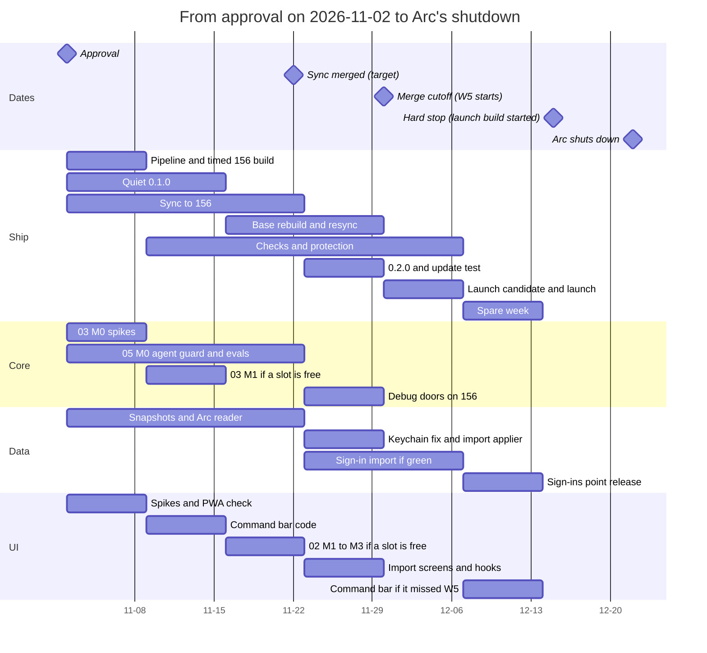
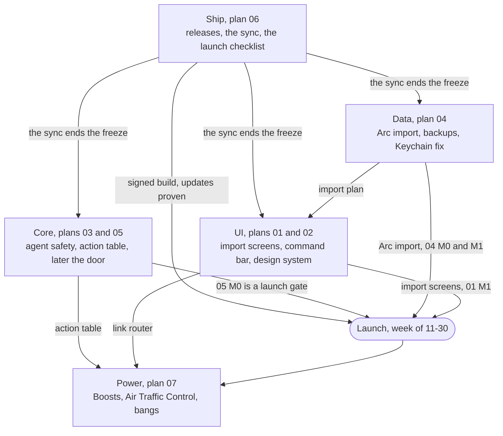

# 00. Master plan

This page fits the seven plans together. It covers the order of work, the
calendar, the threads, and what must be true before launch. Decisions are
cited as D1, D2, and so on, from [decisions.md](decisions.md). Terms such as
W1, the sync, and the door are in the [README](README.md#words-used-here).

## In plain English

Nobody can install rac yet, and Arc shuts down on 2026-12-22. So the first
job is shipping, not redesigning. One thread gets a signed build out, catches
rac up with Helium, and proves that updates work. Three other threads build
what launch needs at the same time: Arc import, a safer agent, and the import
screens. They also start the redesign in rac's own files, so nothing collides
with the Helium update.

rac stays one app. The browser is its own server, and nothing runs in the
background. After launch, outside agents such as Claude Code get a private
door with its own switch, off by default.

Build machines limit the pace more than ideas do. One 16 GB laptop can run at
most two builds at once, so launch work gets the build slots first.

If you approve by 11-02, rac launches in the week of 11-30, with a spare week
before the 12-15 hard stop. If the command bar misses that week, it follows as
a quick update. Bigger changes land in January.

## Product direction

**At launch.** Helium 0.20.1.1 on Chromium 156, with today's sidebar, spaces,
pinned tabs, and favorites. Arc import brings spaces, pins, favorites, and
themes, plus sign-ins if they're ready. The agent's `auto` hole is closed and
tested. With AI off, no AI button, row, or label appears. The release is
signed, updates are proven, and its network hosts are published.

**December and January.** The command bar opens with Cmd+T, with one setting
to keep the new tab page (D13). Then come Peek, the little window for links
from other apps, Clear with Undo, and the shared design system with springs.

**January onward.** One action table drives the sidebar, command bar,
shortcuts, and agents, so safety rules live in one place. The opt-in door
opens for outside agents. Chats move to an encrypted local store. Spaces can
get separate sign-ins. Boosts, Air Traffic Control, and bangs follow.

**What never changes.** There is no server, no account, and nothing phones
home. AI is off by default and costs nothing when off. rac stays on Chromium's
Views UI, as quilt patches on Helium.

## Order of work

Two dates are fixed. The launch build must start by Tue 2026-12-15, and Arc
shuts down on Tue 2026-12-22.

| Option | For | Against |
| --- | --- | --- |
| A. Ship 0.1, then revamp, one after the other | No collisions. The shared Mac is free for the sync | Five weeks with nobody on UI or architecture. The command bar slips to February |
| B. Revamp first, launch later | Arc users see the new rac on day one | Misses 12-22. Failed hunks went from 43 to 104 in one Helium release, and every revamp patch gets rebased twice |
| C. A stable track ships while the revamp runs on branches (recommended) | Hits 12-22 with updates proven. No thread waits idle | Build slots are the bottleneck, so some revamp work is written early and built later |
| D. Launch on Chromium 154, sync after | The fastest launch | Two Chromium majors old, and the 156 pipeline unproven |

**Recommendation: C, approved by 11-02 (D1, D2).** Ship runs plan 06 on
`main`. The other threads build in rac-owned files on Chromium 154 branches,
rebase onto 156 after the sync, and merge what is ready by the start of W5.
The rest ships in a point release or in January.

If approval slips to 11-09, there is no spare week. Plan a sidebar-only import
(D43) and expect the command bar in a point release. After 11-09, option D is
the fallback. If the sync isn't merged by the end of W4, Ship holds one week
and then launches on 154 (D8).

## Calendar

This assumes approval on Mon 2026-11-02. Weeks start on Mondays.

Your own steps are few. You sign up for Depot on day 1 of W1 (D4) and run
the Arc scrub script in W1 (D41). Ship asks you to protect `main` by W4
(D10). Week-by-week detail is in
[plan 06's critical path](06-engineering-and-shipping.md#critical-path).

**After launch.** Ship runs the first regular sync in W6 or W7 (D18), then
the beta channel, crash reports, and the plain-folder move (D58). Core builds
the door, then the warm agent, then the agent workspace with UI. Data builds
the full safety net, the partition spike (D46), and the AI store. UI puts
Cmd+S and edge reveal on springs and builds Peek, the little window, and
Clear. Power starts. Core's patch thinning (03 M4) comes last.

**Effort before launch.** The plans add up to 114 to 156 agent-days in five
weeks. Two build slots on the Air can't serve all of it. Only the launch-gate
work, about 57 to 77 agent-days, is required.

## Threads

There are five threads. Ship, UI, Core, and Data start after approval. Power starts
after launch. Each thread opens PRs (D9b), and you approve every merge. Opus
leads every thread, and UI work stays on Claude models. Each thread's shared
files and coordination rules are in its brief in [threads/](threads/).

| Thread | Before launch | After launch | Machine |
| --- | --- | --- | --- |
| Ship (06) | 06 M0 to M5: pipeline, 0.1.0, the sync, 0.2.0, checks, launch. Owns `patches/series` order, `.github/`, and the gate checklist | Regular syncs, beta channel, crash reports, plain-folder move (D58) | The Mac from D5 for the sync. Depot compiles releases. Signing runs on a GitHub-hosted runner, so keys never reach Depot (D4) |
| Core (03, 05) | 05 M0, the launch gate, including the debug doors. 03 M0 spikes. 03 M1 action table if a slot allows | The door (03 M2 with 05 M1), the warm agent (03 M3), 05 M2 and M3, thinning (03 M4) last | Base Mac, one worktree |
| Data (04) | 04 M0 and M1, both launch gates. M2 sign-ins if ready | Full safety net, partitions (D46), encrypted AI store, more importers | Base Mac, one worktree with a light unit-test build |
| UI (01, 02) | 01 M0, M1 import screens, M2 command bar. 02 M0 to M3. The screenshot harness | 02 M4 springs. 01 M3, M4, and M6. The Agents section (01 M5) with Core | Base Mac, at most two worktrees |
| Power (07) | Only 07 M1's pure logic, with unit tests and no build slot | 07 M0 to M5, after Core's table and UI's router land | Any Mac with a free slot |

### Rules for every thread

1. Each shared file has one owner, named in the briefs. Others ask or wait.
2. Nothing under `patches/` merges until the sync does (D11). Then every
   branch rebases.
3. In `patches/series`, append only inside your group's block and run
   `he validate series` in every PR. Ship settles the order.
4. Every PR states its change in net-diff hunks (D17).
5. The plain-folder move and thinning run in announced quiet weeks with no
   open PRs on those groups.
6. Threads never take the foreground or open a real profile. They use only
   `worktree.sh run` and the `--rac-window-screenshot` harness.

### Machine rules

- The Air is the base Mac today. It is an M1 with 16 GB and 101 GB free. It
  runs one full build or two incremental builds at a time, never both.
- Build slots go to launch gates first (05 M0, 04 M0 and M1, the PWA check,
  01 M1), then 01 M2, then 02 M1 to M3 and 03 M1.
- The base rebuild after the sync blocks every worktree on that Mac in W3 and
  W4, unless worktrees clone the sync worktree's built tree instead (D6).
- If the Pro qualifies (D5), it runs the sync and holds the 156 base. It is
  your main machine, so it will be slow while it builds.
- kainoas-linux-mba runs patch-only checks. It can't build the Mac app.

## Launch gates

This is the one gate list. Plan 06 M5 checks every item before the launch
candidate builds.

| # | Gate | From |
| --- | --- | --- |
| G1 | Arc sidebar import brings spaces, pins, favorites, open tabs, and themes. A rerun adds nothing, Undo works, and the import makes zero network requests. Includes plan 01's import screens and the "what didn't come over" list. Sign-ins are not required | 04 M1, 01 M1 |
| G2 | A snapshot before every import, and the restore prompt after a corrupt `Preferences` | 04 M0a |
| G3 | The Keychain "no silent reset" fix, with its unit test | 04 M0b |
| G4 | Agent safety floor: the taint rule, fail-closed defaults, page-text marking, tier 1 evals green within the false-card budget, and AI-off test set 1 | 05 M0 |
| G5 | Debug doors refused on the real profile | 05 M0 (D20) |
| G6 | Dev switches compiled out of release builds, including plan 02's frame-log and contrast flags and plan 04's `--rac-import-source-root` | 05 M0, 02 M0, 04 M1, 06 |
| G7 | Public copy matches behavior: the onboarding promise, "It asks before it acts", "thin layer", "four weeks", and the `ai.md` table | 05 M0, 06 M5 |
| G8 | The synced build passes the surface matrix, including an installed web app (PWA) window, with no AI labels when AI is off | 06 M2, 01 M0 and M1 |
| G9 | The signed, notarized, synced build passes `install-smoke` and `update-smoke` from 0.1.0 to 0.2.0. The bad-release runbook exists | 06 M1, M3 |
| G10 | The network host list is published from a capture | 06 M4 |
| G11 | Speed numbers against Helium are published, or the site line is softened (D60) | 06 M4 |
| G12 | A DRM test page is checked before any Widevine claim | 06 M5 |
| G13 | `main` is protected (D10) | 06 M4 |
| G14 | A clean runner goes from download to imported Arc spaces in under 5 minutes, on video | 06 M5 |
| G15 | With AI off, no AI button, row, or label appears on any surface a launch PR touched | All plans |

These are not gates: the command bar (D16), sign-in import (04 M2), plan 02's
polish, plan 07 M1, Peek, the little window, and Clear.

## After your review

0. Update your main checkout first. Its `main` is 71 commits behind
   `origin/main` (checked 2026-10-27), so every worktree would clone a stale
   base. It also has an uncommitted `.gitignore` change and is in the merged
   state, so deal with both. Then run
   `git -C /Users/knewton/Dev/Github/rac pull --ff-only` and one incremental
   `source dev.sh && he build` there. That build needs your approval (D6). No
   thread starts before this is done.
1. You edit the plans and answer [decisions.md](decisions.md), group A first.
2. VISION.md, AGENTS.md, and `docs/roadmap.md` change only with your sign-off.
3. The four threads launch, each from its brief in [threads/](threads/) plus
   this page. Not before.
