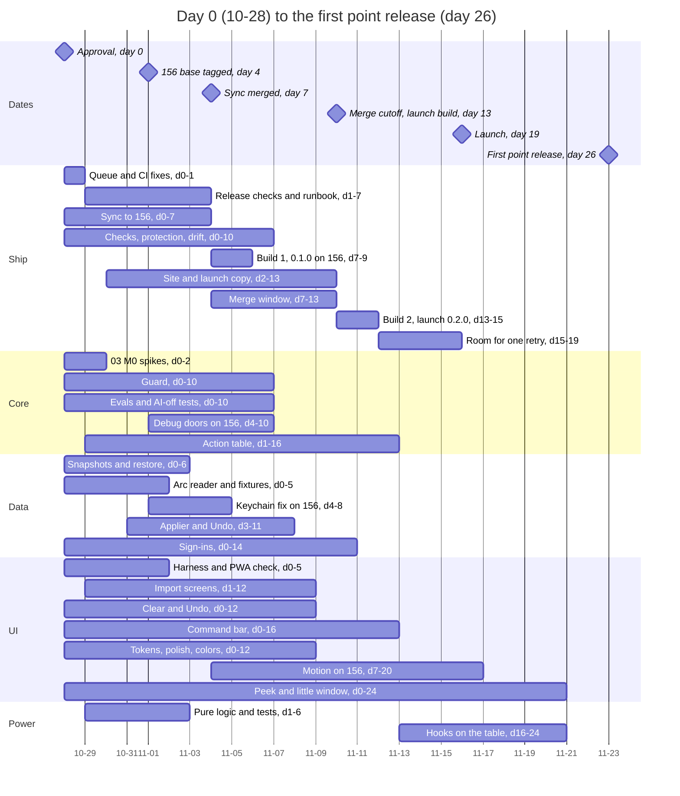
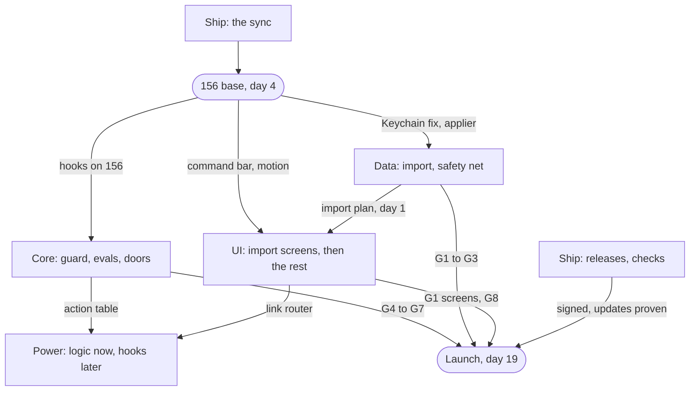

# 00. Master plan

This page fits the seven plans together: the order of work, the calendar,
the threads, the machines, and the launch gates. Decisions are cited as D1,
D2, and so on, from [decisions.md](decisions.md). Terms such as day 7 and the
156 base are in the [README](README.md#words-used-here).

## In plain English

Nobody can install rac yet, so shipping comes first. One thread gets a
signed build out, catches rac up with Helium, and proves updates work. Every
other thread starts the same day, split into small parallel streams.

If you approve on Wed 10-28 (day 0), rac launches on **Mon 2026-11-16, day
19**. If every gate is green early, it can launch Thu 11-12 (day 15). The
12-15 hard stop and Arc's shutdown on 12-22 are now safety margins.

Agents are not the limit. Two things are:

- **Builds.** A free CI release build takes about 1.5 days, and a Mac builds
  one or two things at once. So builds are rare and run in the background,
  and nobody waits on one.
- **Your reviews.** You approve every merge, and most land in days 7 to 13.

## Product direction

**At launch, day 19.** Helium 0.20.1.1 on Chromium 156, with today's
sidebar, spaces, pinned tabs, and favorites. Arc import brings spaces, pins,
favorites, and themes. The `auto` hole is closed and tested. With AI off, no
AI appears. The release is signed, updates are proven, and network hosts are
published. Clear, sign-ins, and the command bar join if merged by day 13.

**First point release (P1), about day 26.** What missed day 13, plus Cmd+S
and edge reveal on springs and Power's clean links.

**Days 20 to 55.** Peek, the little window, the action table, the door, the
warm agent, the agent workspace, separate sign-ins per space, Boosts, Air
Traffic Control, and bangs. Thinning may run into January.

**What never changes.** No server, no account, nothing phones home. AI is
off by default and costs nothing when off. rac stays on Views, as patches on
Helium.

## Order of work

The order is still ship, sync, launch, with the revamp alongside (D2). What
changes is the overlap:

1. **Every thread starts on day 0,** split into 20 streams. A stream is one
   worktree with one lead agent, chosen so streams don't share files.
2. **No long freeze (D62).** Until the sync compiles, streams write
   rac-owned files on Chromium 154 and check each API they call against the
   156 sources. About day 4, Ship tags the compiling sync as the **156
   base**. Streams clone its built tree and write their hooks on 156. When
   the sync merges, about day 7, they rebase onto `main` with little to fix.
3. **A build queue on each Mac (D63).** Agents write code, tests, and
   reviews without building. Builds run one or two at a time. Agents verify
   in batches: one build, then every test and screenshot it allows.
4. **Two release builds, fire-and-forget (D4, D64).** Both come from the
   synced 156 tree. Build 1 is 0.1.0, quiet and unannounced, fired when the
   sync merges, about day 7. Build 2 is the launch build, 0.2.0, fired on day
   13. A thread starts one and keeps working. Only publishing waits.

**Truly sequential:** 0.1.0 is published before an update can be proven, and
the proof runs on the launch build on day 15. If build 1 slips, the proof
moves to the first point release, and launch is not blocked on it unless the
maintainer says so. The sync compiles before hooks go into Helium-shared files, and merges before
the launch build. Gates G1 to G7 merge before the launch build starts. The
launch build finishes before the last update test, the video (G14), and the
post. Everything else overlaps.

**If the sync slips (D8),** launch waits. Launching on 154 is the fallback
only if the sync isn't merged by day 30 (11-27).

## Calendar

Day 0 is Wed 2026-10-28. Days are calendar days.

**Your steps.** Day 0: merge PR #20, run the Arc scrub script (D41), and
send the Pro's specs (D5) once it is online. Step 0 and the build approvals
(D6) are done. By day 5: create `rac-bot` and protect `main` (D10). About day
9: publish 0.1.0 quietly. Days 7 to 13: review merges. About day 12: the
by-hand Arc sign-in check. Day 15: publish the launch build quietly. Day 19:
post. Later, not on day 0: ask Depot about sponsorship. Paid Depot needs your
word, and only if a free build fails twice.

**After launch,** Ship starts the next sync at once (D18). Other timings are
in the table at the end.

## Thread map

All five threads start on day 0. Each opens PRs (D9b), and you approve every
merge. Opus leads each thread, and UI stays on Claude models. Briefs are in
[threads/](threads/).

| Thread | Streams | Gates |
| --- | --- | --- |
| Ship (06) | `ci` (queue, pipeline, releases), `sync`, `checks` (PR checks, protection, drift, host list, bench), `site` | G9 to G14 |
| Core (03, 05) | `guard` (taint rule, fail closed, page-text marking), `evals`, `doors` (on 156 from day 4), `table` (spikes, then the action table) | G4 to G7 |
| Data (04) | `net` (snapshots, then the Keychain fix on 156), `reader`, `apply` (from day 3), `signins` | G1 to G3 |
| UI (01, 02) | `tools` (harness, frame log, PWA check), `import`, `bar`, `peek`, `clear`, `design`, `motion` (from day 7) | G1 screens, G8, G15 |
| Power (07) | `logic` (pure logic and unit tests; hooks after Core's table) | None |

### Rules for every thread

1. Each shared file has one owner, named in the briefs. Others ask or wait.
2. Nothing under `patches/` merges before the sync (D62). Then Ship runs
   the merge order: the harness, then gates, then the rest. Launch merges
   close at the start of day 13.
3. Append to `patches/series` and `rac_strings.grdp` only inside your own
   block. Run `he validate series`.
4. Every PR states its net-diff hunks (D17).
5. Every build goes through the queue (D63).
6. Post done work's before and after screenshots in the chat, plus a video
   for motion or interaction ([threads/README.md](threads/README.md)).
7. Never take the foreground or open a real profile. Use `worktree.sh run`
   and the screenshot harness only.

### Machine rules

- **The Air** (M1, 16 GB, 101 GB free) is the base Mac. Its queue has two
  build slots. A full build takes both and runs overnight.
- **Light worktrees first.** A stream starts as a git-only worktree and runs
  `worktree.sh setup` when its first batch is ready to build.
- **About 10 agent sessions on the Air** at once, to start. Leads stagger
  streams and watch memory.
- **Moving to 156** means a new worktree from `worktree.sh setup <156
  base>`, never `worktree.sh sync`, which would be a full build. Ask before
  removing the old worktree.
- **The main checkout** stays on 154 until after launch. After the sync,
  every `setup` names the 156 base.
- **The Pro (D61)** is approved but offline (last seen on Tailscale 2 days
  ago). The Air does everything until it is back. Once it is online and D5
  qualifies, it can host a 156 base, one build at a time. The Air then builds
  its own 156 base once, on day 4.
- **kainoas-linux-mba** runs patch-only checks. Signing stays on GitHub.

## Launch gates

The one gate list. Plan 06 M5 checks it before the launch build on day 13.
G9, G10, and G14 run again on the launch build. Details are in each plan.

| # | Gate | From | Ready |
| --- | --- | --- | --- |
| G1 | Arc sidebar import with its screens: rerun adds nothing, Undo works, zero network requests. Sign-ins not required | 04 M1, 01 M1 | Day 12 |
| G2 | Pre-import snapshot and the restore prompt | 04 M0a | Day 8 |
| G3 | Keychain "no silent reset" fix, with its test | 04 M0b | Day 8 |
| G4 | Safety floor: taint rule, fail closed, page-text marking, tier 1 evals, AI-off set 1 | 05 M0 | Day 12 |
| G5 | Debug doors refused on the real profile | 05 M0 (D20) | Day 10 |
| G6 | Dev switches compiled out of release builds | 05 M0, 02 M0, 04 M1 | Day 12 |
| G7 | Public copy matches behavior | 05 M0, 06 M5 | Day 12 |
| G8 | The synced build passes the surface matrix, PWA windows included | 06 M2, 01 M0 | Day 7 |
| G9 | Signed, notarized synced build passes install tests (0.1.0) and the update test from 0.1.0 (launch build); bad-release runbook | 06 M1, M5 | Days 9, 15 |
| G10 | Network host list published from a capture | 06 M4 | Days 10, 15 |
| G11 | Speed numbers published, or the site line softened (D60) | 06 M4 | Day 10 |
| G12 | DRM test page checked | 06 M5 | Day 10 |
| G13 | `main` protected (D10) | 06 M4 | Day 5 |
| G14 | Download to imported Arc spaces in under 5 minutes, on video | 06 M5 | Day 15 |
| G15 | With AI off, no AI on any surface a launch PR touched | All | Day 12 |

Not gates: the command bar (D16), sign-ins (04 M2), Clear, plan 02's polish,
plan 07 M1, Peek, and the little window.

## Builds you approve

AGENTS.md forbids full builds and `he reset` without your approval. Before
launch, this plan asks for these and no others (D6):

1. **Step 0, day 0 (done):** one incremental `he build` in the main
   checkout, pulled to d3f0d66 and synced. The build is running.
2. **The sync's cold build, day 0:** one full 156 build in the sync
   worktree. Helium's patches build first, overnight, while agents fix
   rac's. rac's patches then build on top, incrementally.
3. **Cloning the 156 base, from day 4:** `worktree.sh setup <sync
   worktree>` on the same Mac. No new full build.
4. **Only if the sync moves to the Pro (D61):** one cold 156 build on the
   Air, in a `base-156` worktree, day 4, overnight. Not needed while the Pro
   is offline.
5. **CI release builds (D64):** 0.1.0 about day 7, from the synced tree, and
   the launch build 0.2.0 on day 13. Paid Depot only if a free build fails
   twice, and only on your word.

Not asked for: `he reset` in the main checkout. Its one 156 rebuild after
launch is optional and asked for separately.

## After your review

0. Done: the main checkout was pulled to d3f0d66 and synced, and
   `source dev.sh && he build` is running there. Threads start in light
   worktrees while it runs.
1. Group A of [decisions.md](decisions.md) is answered except D5 (the Pro's
   specs; the Pro is offline).
2. VISION.md, AGENTS.md, and `docs/roadmap.md` change only with your OK.
3. All five threads launch from their briefs plus this page.

## Milestone timing for plans 01 to 07

Days from approval. **L** is the launch build. **L/P1** is the launch if
merged by day 13, else the first point release, about day 26.

| Milestone | Days | Ships | Stream |
| --- | --- | --- | --- |
| 01 M0 tools, spikes | 0-5 | None | ui tools, peek, clear |
| 01 M1 import screens | 1-12 | L | ui import |
| 01 M2 command bar | 0-6 on 154, hooks 4-16 | L/P1 | ui bar |
| 01 M3 Clear | 0-12 | L/P1 | ui clear |
| 01 M3 Peek, little window | Spike 0-3, build 5-24 | P1 or later | ui peek |
| 01 M4 sidebar times | 7-16 | P1 | ui motion |
| 01 M5 Agents section | Design by 3, build 25-45 | With 05 M2 | ui peek |
| 01 M6 | 30 on | Later | UI |
| 02 M0 rig | 0-4 | None | ui tools |
| 02 M1 tokens, springs | 0-5 | L/P1 | ui design |
| 02 M2 polish | 3-12 | L/P1 | ui design |
| 02 M3 space colors | 3-9 | L/P1 | ui design |
| 02 M4 motion on 156 | 7-20 | P1 | ui motion |
| 03 M0 spikes | 0-2 | None | core table |
| 03 M1 table (tasks 1, 3) | 1-16 | After launch | core table |
| 03 M1 split (tasks 2, 4) | 13-22 | After launch | core table |
| 03 M2 door, with 05 M1 | 14-30 | Point release | core guard |
| 03 M3 warm agent | 22-30 | Point release | core table |
| 03 M4 thinning | 40 on | Later | Core |
| 04 M0a snapshots | 0-6 | L | data net |
| 04 M0b Keychain fix | 4-8 | L | data net |
| 04 M1a reader | 0-5 | L | data reader |
| 04 M1b applier, Undo | 3-11 | L | data apply |
| 04 M2 sign-ins | 0-14 | L/P1 | data signins |
| 04 after launch | Partitions 14-28, AI store 20-35 | Later | Data |
| 05 M0 safety floor | 0-12 | L | core guard, evals, doors |
| 05 M1 read-only door | 14-30 | Point release | core guard |
| 05 M2 workspace, write tier | 25-45 | Point release | Core with UI |
| 05 M3 | 45-55 | Later | Core |
| 06 M0 pipeline, queue | 0-1 | None | ship ci |
| 06 M1 0.1.0 (checks 1-7, build fired about 7, published about 9) | 1-10 | 0.1.0 | ship ci |
| 06 M2 sync | 0-7, slack to 10 | 0.1.0 | ship sync |
| 06 M3 evidence on 0.1.0 | 9-10 | None | ship ci, checks |
| 06 M4 checks, evidence | 0-10 | L | ship checks |
| 06 M5 launch, with the update proof | Site 2-13, build 13, proof 15, post 19 | L, 0.2.0 | ship site, ci |
| 06 later | Next sync 19-33, beta 20-30, crash reports 25-40, folder move about 40 | Later | Ship |
| 07 M0 matcher, fields | 1-6, fields 16-20 | P1 | power logic |
| 07 M1 Arc habits | Logic 1-6, hooks 16-24 | P1 | power logic |
| 07 M2 Boosts | Spike 10-14, build 20-40 | Later | Power |
| 07 M3 Air Traffic Control | 24-35 | Later | Power |
| 07 M4 bangs editor | 16-26 | Later | Power |
| 07 M5 bangs label | Go or no-go about 35 | Later | Power |
