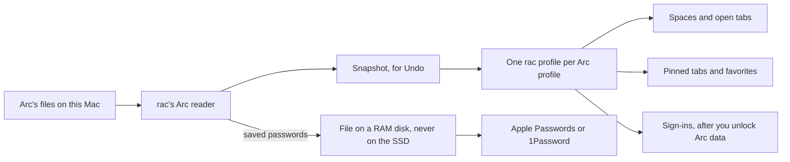

# 04. Data, storage, import, and sync

You only need to read the first two sections. The rest is detail for the build thread.

## In plain English

An Arc user who opens rac today gets an empty sidebar and no sign-ins. This plan fixes both before Arc shuts down on 2026-12-22.

rac reads Arc's files and rebuilds each Arc space as a rac space. Names, emoji, pinned tabs, folders, open tabs, and favorites come over. Colors come close to Arc's. Each Arc profile becomes a rac profile with its own window. Sites stay signed in, though some, like Google, may ask again.

rac has no password manager. If a one-day test passes, rac hands Arc's passwords to Apple Passwords or 1Password through a RAM disk, a disk held in memory that never touches the SSD. Until rac removes the file, any app you run can read it. If the test fails, rac shows how to export them from Arc.

rac saves a snapshot before each import, so you can undo the sidebar part.

## What you need to decide

| Id | Question | Options | Recommended |
| --- | --- | --- | --- |
| 04-D1 (D43) | What does the pre-launch import bring? | Sidebar only; sidebar plus sign-ins; also passwords | Sidebar plus sign-ins, from Arc only |
| 04-D2 (D44) | How do Arc profiles map? | All into one profile; one rac profile each; per-space sign-ins in one window | One rac profile for each Arc profile |
| 04-D3 (D45) | How do saved passwords move? | RAM-disk file; guide Arc's own export; plaintext file on the SSD; Chromium's password manager | The RAM disk if a one-day test passes, else Arc's export |
| 04-D4 (D41) | What real Arc data can we test on? | You run a scrubbing script on your Arc; volunteer samples after beta; made-up data only | The scrubbing script now, plus volunteers after beta |
| 04-D5 (D42) | How big is the safety net before launch? | Snapshot, one rolling backup, and the Keychain fix; also 14-day backups and a Restore screen | The small set now, the rest after launch |
| 04-D6 (D46) | After launch, how do spaces get separate sign-ins? | A storage partition per space; a full profile per space | A partition per space, tried in a spike first |
| 04-D7 (D47) | After launch, how are AI chats and agent runs stored? | Encrypt today's JSON files; one encrypted SQLite database with retention | One encrypted SQLite database |
| 04-D8 (D55) | Sync between Macs? | None; an export file; encrypted folder sync; Helium's vault | An export file after launch |

- 04-D1. If sign-ins aren't merged by day 13, or approval comes after about 12-02, launch with the sidebar only.
- 04-D2. It is the cheapest correct path before 12-22. Two Arc profiles mean two windows.
- 04-D3. A plaintext file on the SSD needs your sign-off.
- 04-D4. The script swaps every title and URL for a placeholder. You run it, and agents never read your real Arc data.
- 04-D5. The Keychain fix stops rac from silently replacing the key that protects its encrypted data.
- 04-D6. A partition is a separate cookie and storage jar inside one profile.
- 04-D7. It also covers plan 05's chat-encryption item.
- 04-D8. Folder sync would need a VISION.md change.

## Where we are today

FACT unless tagged. `CR:` is the built tree at `/Users/knewton/Dev/Github/rac/build/src` (Chromium 154).

| Data | Where | Format | Source |
|---|---|---|---|
| Spaces: id, name, emoji, theme, last active | Pref `rac.spaces` | JSON in `Preferences`; unknown fields kept | `CR:chrome/browser/rac/spaces/space.h:22-80` |
| Themes | Inside each space: two color stops plus mode | Same | `space.h:22-43` |
| Hidden spaces' tabs | `<profile>/rac spaces`, plus `.bak` | JSON `kVersion = 1`, atomic, 1 s coalesce | `CR:chrome/browser/rac/spaces/spaces_store.h:64-74` |
| Favorites, pinned tabs, folders (one level) | Pref `rac.sidebar.lists` | JSON in `Preferences`. `SidebarItem` holds only id, url, title, name, and **keeps no unknown fields** | `CR:chrome/browser/ui/rac/sidebar/sidebar_items.h:38-50` |
| Tab-to-space and tab-to-item tags | Chromium session extra data | Session format | `docs/internals/pinned-tabs.md` |
| Agent site rules, permission level | `rac.ai.agent_site_rules`, `rac.ai.agent_permission_level` | Prefs | `patches/rac/agent/14-site-rules.patch:598-603`; `13-permission-levels.patch:573-579` |
| Settings | `rac.*` prefs; `rac.browser_updates` in Local State | JSON | `plans/research/rac-baseline.md:325-326` |
| AI keys | `rac.ai.encrypted_keys` | `os_crypt_async`, Keychain "rac Storage Key" | `CR:chrome/browser/rac/ai/ai_prefs.h:24-26` |
| AI chats | `<profile>/rac_ai_history.json` | **Plaintext JSON** | `rac-baseline.md:329` |
| Agent run logs | Not stored | n/a | `rac-baseline.md:319-334` |

**Facts that shape this plan.**

- **Preferences is a single point of failure.** If `Preferences` is corrupt, Chromium renames it `Preferences.bad` and starts with defaults (`CR:components/prefs/json_pref_store.cc:55-58,141`). Spaces and pins live there, with no `.bak`.
- **Helium's Arc importer can only make bookmarks.** It runs in the utility process and returns data only through the importer bridge (`CR:chrome/utility/importer/arc_sidebar_importer.cc:268-330`). It reads the space list from `containers[1]` by fixed index. It names folders by the space's internal id.
- **Helium imports little else.** It imports bookmarks, history, and extensions from Chromium browsers (`CR:chrome/common/importer/chrome_importer_utils.cc:192-226`). It strips passwords from every source (`CR:chrome/browser/importer/importer_list.cc:257-260`). Cookies are "Not supported yet" (`CR:components/user_data_importer/common/importer_data_types.h:27`).
- **There is no password manager to fill.** Helium forces the password manager off by policy (`helium-chromium/patches/helium/hop/disable-password-manager.patch`).
- **The Keychain reset path exists in rac's tree.** It is find-then-add: on `errSecItemNotFound` it adds a fresh key, which can overwrite an item that has just appeared (`research/ardia.md:546-553`, citing `CR:components/os_crypt/common/keychain_password_mac.mm:64-65,92-95`). Helium's macOS patch also edits that file for denied access (`patches/helium/macos/prevent-reset-on-keychain-unavailability.patch`).
- **Onboarding already has an import step.** It calls Helium's `listImportableProfiles` and `importProfile` (`patches/rac/onboarding/03-tour-window.patch:24-28`).
- **Chromium has the building blocks.** It can isolate cookies per space (`CR:content/public/browser/site_instance.h:255`; `digests/long-tail.md:23`). It has versioned SQLite (`CR:sql/meta_table.h:75,122`).

## What others do

Full tables: `matrices/architecture-and-storage.md` (Matrix B) and `matrices/features.md` (Import, Sync and backup).

- **Cra**: plain JSON files with one `.bak` and a launch-time repair. It reads Arc's sidebar, favicons, archive, windows, and routing rules exactly. It re-encrypts passwords and cookies into a 0600 staging file and writes them before Chromium opens its databases (`research/cra.md:375-432,604-637`). It has no Arc fixtures; the code is the only record of the format.
- **Ardia**: imports Arc spaces, pins, folders, live folders, and themes. It turns each Arc space into a profile, which loses shared logins (issue #50). Its own review says to map Arc profile → profile and Arc space → space (`research/ardia.md:55,554-558`). It syncs sealed files through iCloud Drive and never tested two Macs (`digests/ardia.md:79-86`).
- **Zen**: 3-hour backups, the newest 20, but only two fallbacks. Data-loss reports followed its storage moves (`digests/zen.md`, Avoid 8). **Nook**: daily backups kept 7 days (`matrices/architecture-and-storage.md:33`).
- **T3 Code**: an event log grew to 17-40 GB. It snapshots its database before updates (`digests/t3code.md:86-98`).
- **Stedding and Brave**: one storage partition per space or container. Brave carries the partition through restore with a URL prefix (`digests/long-tail.md:20-25`).

## Options

These options are about what ships before 2026-12-22 and how Arc profiles map. The storage work after launch has its own section and decisions (04-D5 to 04-D8).

### Option A: Sidebar only, into the current profile

rac rebuilds Arc's spaces, pins, folders, and favorites in the profile the user is in. Every Arc profile's spaces land in that one profile. Nobody's sign-ins come over.

- **Details.** A rac-owned reader and applier. Helium's importer brings history and extensions as a separate step.
- **Pros.** Smallest change, about 3-4 upstream hunks. Easiest to fit before the launch.
- **Cons.** Everyone signs in again everywhere. Work and personal spaces end up sharing one cookie jar.
- **Effort.** M, 7-9 agent-days. **Risk.** Low. **Locks in.** Nothing.

### Option B: Sidebar plus sign-ins, Arc profile → rac profile (recommended)

Each Arc profile becomes a rac profile with its own window. Its spaces, favorites, and cookies go into that profile. Most Arc users have one profile, so they get one window, as before. Users with Work and Personal profiles get two windows.

- **Details.** This is Option A, plus creating profiles from the import sheet, plus a cookie reader and writer. It matches rac's own model, where profiles keep logins separate (VISION). Arc's Top Apps were per profile, so favorites map exactly (`research/cra.md:614`). No partition, no navigator hook, and no edits to session restore.
- **Pros.** Every Arc profile's sign-ins arrive before Arc closes. Undo is clean for extra profiles: deleting the created profile removes them. It is the cheapest correct mapping.
- **Cons.** Spaces from different Arc profiles live in different windows. In Arc they shared one window. Switching between them is a window switch until plan 01 adds a profile hop. Imported cookies may not satisfy sites that bind sessions to a device.
- **Effort.** M, 13-17 agent-days in total. **Risk.** Medium: Keychain and macOS prompts, cookie edge cases. **Locks in.** Imported Work spaces live in their own profile. Merging them into one window later needs per-space sign-ins (04-D6) plus a "move space to profile" tool.

### Option C: Sidebar plus sign-ins, all in one window, a jar per Arc profile

This is Arc's real model: one window, with spaces backed by separate cookie jars.

- **Details.** It needs storage partitions per space, restore hooks, and clear-data reach before launch (see After launch, part 2). Those edit hot files shared with Helium, so they wait for the sync.
- **Pros.** The truest copy of Arc.
- **Cons.** L effort, with hunks in `browser_navigator.cc` and session restore. It cannot fit between the sync (about day 7) and the launch build (day 13).
- **Effort.** L, 15-25 agent-days. **Risk.** High for the date. **Locks in.** The partition design, untested.

### Recommendation

**Option B.** It is the only option that brings every sign-in before Arc closes without touching hot files. Option C stays the after-launch goal for users who want one window. From A, keep the rule that sidebar import ships even if sign-ins slip.

## Recommended plan

**Calendar rules (`plans/rulings.md`, ruling 1).** Days count from approval (day 0, Wed 10-28). Plan 06 owns the sync and the launch calendar, and the master plan's closing table owns the timing. Work in rac-owned new files may be built on Chromium 154 and rebased later. Hooks in files Helium also patches are written on the 156 base, tagged about day 4 (D62). The launch build starts on day 13 and launch is day 19. The launch build's hard stop on **2026-12-15** and Arc's shutdown on **2026-12-22** are now safety margins.

**Dependencies.** On days 0 to 7 (slack to day 10), plan 06 M2 syncs to Helium 0.20.1.1 (Chromium 156). Nothing under `patches/` merges until the sync does, about day 7 (D11 and D62 in decisions.md: a one-week freeze, not a long one). About day 4, Ship tags the compiling sync as the 156 base, and import worktrees clone its built tree (plan 06; builds go through the D63 queue). There is no hop to Chromium 157 before launch (plan 06). Every milestone below targets Chromium 156.

**Test status.** Fixture tests report through the worktree-posted test status (06 M4 task 2), not CI. CI does not compile C++ tests before launch.

**Critical path.**

| Days after approval | Work | Chromium | Merges? |
|---|---|---|---|
| 0 to 6 (M0a), 0 to 5 (M1a) | M0a snapshot service; M1a reader, import plan, scrub script, fixtures. All new files | 154, rebased later | After the sync (about day 7) |
| 4 to 8 (M0b), 3 to 11 (M1b) | M0b Keychain fix; M1b applier, hooks, plan 01's screens | 156 base | After the sync, in Ship's merge order |
| 0 to 14 (M2) | M2 profiles and sign-ins | 154, then 156 | After the sync |
| By the start of day 13 | M0 and M1 must be merged for the launch build; M2 should be | 156 | Launch (06 M5, day 19) |

**If it slips.** If M2 isn't merged by the start of day 13, launch with sidebar-only import. Ship sign-ins in the first point release, about day 26, only if `update-smoke` passes (06 M1). Otherwise ship it after. Arc's files stay on disk after shutdown, so import still works (INFERENCE). The budget is 16-21 agent-days before launch. Each day approval comes after 10-28 moves every day here one day later (D1). If approval comes after about 12-02, plan sidebar-only.

### M0. Minimal safety net (S, 3-4 agent-days; M0a days 0 to 6, M0b days 4 to 8)

**Goal.** An import can't destroy a user's sidebar or their encrypted data.

**Tasks.**
1. **M0a, new files.** A rac-owned `DataBackups` service in `chrome/browser/rac/storage/`.
   - Before any import or migration, it writes a named snapshot of `rac.spaces`, `rac.sidebar.lists`, the agent rules, and the `rac spaces` file.
   - It keeps one rolling daily backup with no open-tab data: only spaces, themes, pins, favorites, and rules.
   - The pre-import snapshot is deleted when the 7-day Undo window ends. Open-tab URLs are not kept longer than that (minor 14).
   - Files are 0600, written by `ImportantFileWriter` on a background sequence.
2. **M0a.** If `Preferences.bad` exists and `rac.spaces` is empty, offer "Restore your spaces from <date>." Never restore silently.
3. **M0b, Chromium 156, Opus, 1-2 days.** Fix the Keychain silent reset. On `errSecItemNotFound`, retry before adding. Never overwrite an item that appears in the meantime. Rewrite Ardia's idea; don't copy its 554-line patch (`research/ardia.md:546-553`). Add a unit test with a fake keychain that returns not-found, then found. This is a plan 06 launch gate (cross-plan ruling 13). It is written on the 156 base (days 4 to 8) because Helium's macOS patch edits the same file.

**Acceptance.** Corrupting `Preferences` in a test profile restores spaces and pins after one click. The Keychain test proves no second key is written. Startup reads no backup when the live data is fine.

**Verification.** Unit tests through posted status. A screenshot of the restore prompt in light and dark.

**Patch surface.** One keyed-service registration and one `BUILD.gn` line, plus 1-2 hunks in `keychain_password_mac.mm` (INFERENCE).

### M1. Arc sidebar import (M, 7-9 agent-days; M1a days 0 to 5, M1b days 3 to 11)

**Goal.** An Arc user sees their spaces in rac within a minute.

**Tasks.**
1. **M1a reader** (`chrome/browser/rac/import/arc_reader.{h,cc}`).
   - Pure parsing, no browser state, on a background thread with `base::JSONReader`.
   - Find the data container as the entry in `sidebar.containers[]` that holds `spaces`. Don't rely on a fixed index, as Helium does.
   - Read with Cra's keys (`research/cra.md:609-627`): the flat `[id, object, …]` lists; `containerIDs` (pinned, unpinned); `topAppsContainerIDs`; space `title`, `profile`, `emoji_v2` or `emoji`; `windowTheme` gradients; `data.splitView` and `data.tabGroup`; dates in seconds since 2001; favicons from `SidebarItemsFaviconCache/<md5(id)>`.
   - Also read `StorableLinkRouting.json`, `defaults` `autoArchiveTimeThreshold`, and `extensions.pinned_extensions`.
2. **M1a import plan** (`import_plan.h`). A source-neutral tree, like Cra's `ImportPlan`: profiles, then spaces, favorites, pinned trees, open tabs, themes, emoji, and Arc source ids.
3. **M1a test data (04-D4).** `devutils/rac/arc_scrub.py` copies `StorableSidebar.json` and replaces every title and URL with placeholders, keeping the shape. The maintainer runs it on their own Arc; agents never read real Arc data. Add synthetic edge cases: nested folders, splits, emoji code points, light and dark themes. After the beta, invite two or three volunteer samples through an issue template. A dev switch, `--rac-import-source-root=<dir>`, points the reader at copies. It stays out of release builds.
4. **M1b mapping** (Chromium 156).
   - Arc space → rac space, with name and emoji. The theme takes the first two gradient base colors and the light or dark variant. Overlay colors, intensity, noise, and vibrancy are dropped, so colors are close, not exact (plan 02 may refine).
   - Pinned container → the space's pinned list. Nested folders flatten into their top folder as "Parent › Child", and plan 01's result screen says so. Splits and groups flatten to tabs.
   - Unpinned tabs → open tabs, unloaded. For the space a window shows after import, create unloaded tabs in that window, the same way pinned items open unloaded (`docs/internals/pinned-tabs.md`). For other spaces, write them to the `rac spaces` store.
   - Top Apps → that profile's favorites. Favicons → Chromium's favicon database, so nothing is fetched.
   - Pinned extension ids → Chromium's `extensions.pinned_extensions`.
5. **M1b idempotence.** `SidebarItem` keeps no unknown fields (see "Where we are today"), so the Arc-id-to-rac-id map lives in an import record, `<profile>/rac imports/arc.json` (0600). A rerun skips mapped items. Same-title spaces merge, as in Cra.
6. **M1b applier.** It writes only through `SpacesService` and `SidebarItems`, after the M0 snapshot.
7. **Helium's step, run separately and labeled.** History and extensions, with bookmarks off for Arc. Otherwise pins arrive twice.
8. **Undo, scoped.** "Undo Arc import" works for 7 days and restores the sidebar part only. It leaves history, extensions, favicons, and cookies in place. The result screen says so. It also clears session tab tags that point at removed spaces.
9. **Hand-offs, not imported now.**
   - Routing rules are kept in the import record for plan 07's Air Traffic Control.
   - The auto-archive threshold is kept for plan 01's later auto-archive (cross-plan ruling 4).
   - Arc's archive (`StorableArchiveItems.json`) waits for plan 01's archive store. It is re-read from Arc's folder then, not copied now.
   - Live folders, Boosts, Easels, and Notes aren't imported, because rac has no equivalent.
   - Plan 01's result screen lists all of these.
10. **Screens are plan 01's** (01 M1 task 2). On macOS 27, Helium's Files & Folders prompt (Helium 0.19.4.1) is available only after the sync (`research/helium.md:101`). Whether macOS 27's gate covers Arc's folder is unverified.

**Acceptance.**
- The scrubbed sample and every synthetic fixture import with the right space count, names, emoji, folders, order, and favorites.
- A rerun adds nothing. Undo restores the prior sidebar exactly.
- A net log shows zero requests during import.
- With AI off, no AI rows or labels appear in the import flow (cross-plan ruling 16).

**Verification.**
- Reader unit tests and an applier browser test, through posted status.
- Screenshots of the sidebar before and after import, in light and dark, with the address bar in the toolbar and in the sidebar. Incognito unchanged.
- A video of plan 01's import flow.

**Patch surface.** New files, plus `BUILD.gn`, rac's onboarding handler, and one call that turns off Arc bookmarks. About 2-4 upstream hunks (INFERENCE). No edits to Helium's importer.

### M2. Arc profiles and sign-ins (M, 6-8 agent-days; days 0 to 14)

**Goal.** Each Arc profile arrives as a rac profile, still signed in.

**Tasks.**
1. **Profiles (04-D2).** The Arc `profile` field maps spaces to Arc profiles. The default profile goes into the current rac profile. Each other profile becomes a new rac profile, created with Chromium's profile manager from rac code and named after the Arc profile. The applier then runs per profile. Plan 01 shows one checkbox per profile. Surfaces: multiple profile windows (AGENTS.md).
2. **Credential reader** (`credential_reader_mac.mm`).
   - It asks for Keychain "Arc Safe Storage" only after the user clicks "Unlock Arc data", with an explanation shown first.
   - It copies `Cookies` with `-wal` and `-shm` to a temp folder and opens the copy with `sql::Database`.
   - It decrypts `v10` values: PBKDF2-SHA1 with "saltysalt", 1003 rounds, AES-128-CBC. It checks padding, because a wrong key passes about once in 256 tries. It strips the SHA-256 host prefix at cookie database version 24 and up. Columns are mapped by name.
   - Port from Cra's MIT `CredentialImport.swift`, with credit (`github.com/VictorKildahl/cra` at commit `94c3034`, `Sources/Cra/Services/Import/`).
   - Agents test the reader only on fixture `Cookies` databases encrypted with a fixed test password, through a test-only seam. Tests never call the real Keychain. Real-Arc checks are done by the maintainer by hand, on a second macOS user.
3. **Cookie writer.** It writes through each profile's `CookieManager::SetCanonicalCookie`, and Chromium re-encrypts with "rac Storage Key". INFERENCE: rac is Chromium, so no staging file or restart is needed.
   - Skip expired cookies.
   - Keep `__Host-` and `__Secure-` rules, rejecting rows that break them.
   - Rebuild a partitioned (CHIPS) cookie's partition key from `top_frame_site_key`.
   - Pass options that allow HttpOnly and the same-site context.
4. **Tell the truth in the result.** "Some sites, like Google, may ask you to sign in again." Sites that bind sessions to a device can reject copied cookies (INFERENCE).
5. **Passwords (04-D3).**
   - First, a one-day spike. Decrypt Arc's `Login Data` into a CSV on a RAM volume (`hdiutil attach -nomount ram://…`, then format and mount). The CSV never touches the SSD. Show the file in Finder for Apple Passwords or 1Password to import, and unmount when the sheet closes. A crash or reboot also wipes it.
   - The spike checks two things: that the target apps accept a file from that volume, and how Spotlight and Time Machine treat it.
   - If the spike fails, show steps for Arc's own password export instead. rac never writes a plaintext file without the maintainer's explicit sign-off.
   - Rejected: turning Chromium's password manager back on. Helium forces it off by policy. Undoing that means a rac patch against Helium's policy, plus password settings and autofill surfaces to own (L), against rac's no-password-manager stance (`matrices/features.md`).
   - While mounted, the volume is readable by any process running as the user, including outside agents (plan 05).

**Acceptance.**
- In fixture profiles, cookies are set and sent.
- Manual checks on Google, GitHub, and one bank-style site, run by the maintainer by hand on a second macOS user. Results are recorded, not required to pass.
- Denying the Keychain keeps the sidebar import and shows a calm retry.
- After the hand-off, no password text exists on the SSD (checked with `strings` on the temp folders).

**Verification.** Unit tests: decryption fixtures, the version-24 prefix, wrong-key rejection, cookie prefix rules. Screenshots of the unlock explanation and a two-profile result. A video of the password hand-off.

**Patch surface.** New files. Possibly one hunk to reach profile creation or the cookie manager (INFERENCE).

### After the launch

None of this blocks 2026-12-22. Order follows the master plan: partitions on days 14 to 28 (item 2's spike and in-memory variant first), the AI store on days 20 to 35.

**1. Full safety net (S, 2-3 agent-days).**
- Grow to 14 daily backups (still no open tabs).
- Recovery order: live data, `.bak`, then the newest backups in turn (fixes Zen's two-fallback limit).
- A Restore item in Settings (plan 01).
- One `rac.data_version` integer replaces the two migration booleans, with numbered, idempotent steps after a snapshot.
- Versioning rules go in a new `docs/internals/storage.md`. Each file carries `version` and `min_reader_version`. Builds keep unknown fields, `SidebarItem` included. SQLite uses `sql::MetaTable`.
- The rule: data that grows without limit goes to SQLite with retention. Small, bounded data stays in prefs.

**2. Separate sign-ins in one window (04-D6; L, 15-25 agent-days; spike first).**
- **Spike first.** The first deliverable is a one-week spike on a Chromium 156 tree. A space's tabs open with `CreateForFixedStoragePartition` against `StoragePartitionConfig::Create(profile, "rac", <token>, false)`, from one hook in `browser_navigator.cc` (Stedding ADR 0019).
- **Model.** One jar per space, matching plan 01's toggle (screen 15 of plan 01). Shared jars are left out, because profile mapping covers Arc's case.
- **What the spike must prove:**
  - Restore, rebuilt from the space tag in session extra data (`docs/internals/pinned-tabs.md`).
  - Reopen closed tab and discard.
  - `window.open`, downloads, notifications, DevTools targets, and extension pages.
  - Whether Clear Browsing Data and the site-data settings reach non-default partitions. This is unverified. If they miss them, users would think data is gone when it is not, which breaks the privacy promise. That fix is part of the milestone.
- **Moving a tab** to a space with another jar reopens its URL there.
- **In-memory variant first.** Right after launch, schedule the spike plus the in-memory (no-login) variant ahead of the per-space toggle. Plan 05 M2's outside write tier waits for it. Plan 05 M3 builds its persistent agent identities on the same primitive. Plan 05 M2 and this item both touch `browser_navigator.cc` and session restore, so Data and Core take turns there.
- **Known limit:** `chrome.cookies` without a partition sees only the default jar.
- **Hunks:** 3-6 in hot files, maybe `web_contents_impl.cc` as Brave does (INFERENCE).

**3. Encrypted AI store (04-D7; S-M, 4-6 agent-days; absorbs plan 05's 2-day item).**
- `<profile>/rac_ai.db` via `sql::Database`, WAL mode, versioned with `sql::MetaTable`.
- Tables: conversations, messages, runs, and tool calls. One row per turn and per tool call, never per token.
- Text is encrypted with `os_crypt_async`.
- Chats are kept until deleted. Runs and tool calls are kept 30 days. Plan 05 sets what the audit view shows.
- Migrate `rac_ai_history.json` once, then delete it. The store is created only with AI on.

**4. Export file and more importers (M, 6-10 agent-days).**
- "Export rac setup…" writes a versioned `.rac` JSON file: spaces, themes, pins, favorites, rules, and chosen settings. It never holds cookies, passwords, history, keys, or chats. Importing merges by id.
- Then Zen (spaces from `zen-sessions.jsonlz4`), Safari (its export zip, so no Full Disk Access), and cookies for Chrome and Firefox.
- Dia comes here, not before launch. Dia isn't closing, its pinned tabs sit in an unread SQLCipher `tabs.db`, and its Terms forbid reverse engineering (`digests/ardia.md:78,276-279`). Use AppleScript only.

**5. Sync (04-D8; L, 20-35 agent-days; only if VISION changes).**
- VISION lists sync as "Not planned for now". If the maintainer changes that, use Ardia's design: sealed, immutable files in an iCloud Drive folder or any folder (which covers self-hosting), a 24-word phrase, and per-record last-writer-wins (`research/ardia.md:370-389`).
- Before sync, the sidebar moves out of `Preferences` into a rac-owned record file, with backups first.
- Run a real two-Mac test before shipping; Ardia never did.
- Helium's vault (`digests/helium.md`) could carry Chromium data if it ships. rac runs no server.

## Fit with the non-negotiables

- **Private.** Import reads local files only and makes zero network requests. Rolling backups hold no open-tab URLs, and the pre-import snapshot expires with Undo. Export never holds secrets. **Bent, pending 04-D3:** passwords exist briefly as a readable file, on a RAM volume rather than the SSD, and only with the maintainer's sign-off for any fallback that writes to disk. After launch, separate sign-ins must make Clear Browsing Data reach every partition before shipping.
- **Never slower than Helium.** Backups write at most once a day, on a background sequence. Startup reads nothing extra. Profile mapping adds no hooks to hot paths.
- **AI off costs nothing.** Import and backups never touch AI data. `rac_ai.db` exists only with AI on. No AI labels appear in import screens.
- **Cheap to update.** Before launch, about 4-8 upstream hunks, mostly hooks. No Helium importer files are edited. **Bent:** the Keychain fix edits a file Helium also patches. It is small, and it is the reason M0b is written on the 156 base. After launch, separate sign-ins add hot-file hunks.
- **Calm UI.** One flow, owned by plan 01, with honest result text and scoped Undo.
- **GPL.** Ports from Cra (MIT) and Ardia's own files (Apache-2.0) keep their notices. Stedding and Brave inform the design only. Arc's text and assets are not copied.

## Dependencies on other plans

- **01 ui-shell.** Import screens and the result list (01 M1 task 2). The profile checkboxes and the restore prompt. The separate sign-ins toggle (04-D6, plan 01 screen 15), built after launch. The archive store and auto-archive (ruling 4); plan 04 only hands over Arc's threshold and points at Arc's archive file.
- **02 visual-design-and-motion.** Better theme fidelity, if wanted.
- **03 core-architecture.** All stores live in the browser process, with no helper (03-D1, 03-D2). Plan 04 owns the history schema and retention (after-launch item 3).
- **05 agents-and-ai.** Agent runs use the AI store. Plan 05 M2 (its outside write tier) and M3 build on the partition primitive. Chat encryption is counted once, here.
- **06 engineering-and-shipping.** The sync and the one-week freeze (06 M2, plan 06's default list, D11 and D62 in decisions.md), the 156 base, no hop to 157 before launch, launch gates (06 M5) including the Keychain fix, posted test status (06 M4 task 2), and `update-smoke` for any point release.
- **07 power-features.** Arc routing rules are handed over in the import record.

## Risks and unknowns

- **Real Arc data.** Without the scrubbed sample (04-D4), tests only prove the reader matches Cra's notes.
- **The calendar.** Pre-launch work fits only if approval comes early enough. Nothing merges during the sync (about a week, D62), and builds on the shared Air go through the D63 queue.
- **Prompts.** The Keychain and macOS data-access prompts may confuse users or be denied.
- **Cookies.** Device-bound sessions, schema drift, and prefix rules may make some sign-ins fail.
- **Passwords.** RAM-volume behavior with Spotlight, Time Machine, and the target apps is unknown until the spike.
- **Two windows.** Users with two Arc profiles may dislike getting two windows.
- **Partitions (after launch).** Leaks, and whether Clear data reaches them.
- **Arc after shutdown.** Arc's file formats may change in its last release.

## Open questions

1. Should imported cookies skip known tracker domains? Cra imports everything.
2. Does Arc's `profile` field give readable profile names, or only ids?
3. Is a 7-day Undo window right?
4. Should plan 01 add a quick profile hop in the space switcher, for users with two imported profiles?
5. Should a later tool merge an imported profile into one window as spaces with separate sign-ins?
6. Should the sync key ever live in iCloud Keychain? That needs a team ID; `MAC_TEAM_ID` is empty today (`rac-baseline.md:333`).
7. Note on critique item 15: sync stays in this plan as a short, gated paragraph, because the brief named it in scope. It is not a pre-launch task.

## Draft thread brief

Thread brief: see `plans/threads/data.md`.
