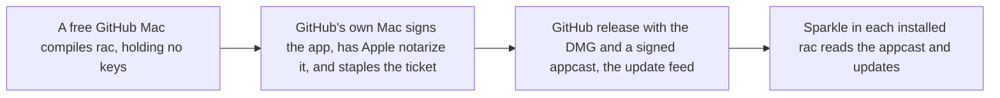

# 06. Engineering platform and shipping

You only need to read the first two sections. The rest is detail for the build thread.

Citation keys: `ci-status` = `plans/context/ci-status.md`. `eng-matrix` = `plans/research/matrices/engineering-and-shipping.md`. Digests are `plans/research/digests/<slug>.md`, cited by slug. The council is `plans/context/inboxzero/{opus,sonnet,kimi-k3}.md`. `run 40222453249` is the last CI validation run (read with `gh run view` and its log artifact on 2026-10-27). FACT = checked in a primary source or the repo. CLAIM = a self-report. INFERENCE = my reasoning.

This plan owns the shared calendar. Days are counted from the maintainer's approval, assumed on Wed 2026-10-28 (day 0). The target launch is **Mon 2026-11-16, day 19**. The old anchors are now safety margins: the launch build must start by 2026-12-15 (day 48), and Arc shuts down on 2026-12-22 (day 55).

## In plain English

Nobody can install rac yet. This plan ships a signed copy, catches rac up with Helium, and launches it for Arc users.

Release builds run on GitHub's free Macs, for Apple Silicon only. One takes about 1.5 days, and none has finished yet. The maintainer will ask Depot about free open-source runners later, not on day 0. rac pays for Depot only if a free build fails twice, and only on the maintainer's word. That is fine because nothing waits on a release build: a thread starts one and keeps working.

There are two release builds before launch, both from the synced Chromium 156 tree. First rac catches up with Helium, from Chromium 154 to 156, in about a week. Build 1 is 0.1.0, quiet and unannounced. It starts when the sync merges, about day 7. Build 2 is the launch build, 0.2.0, with Arc import and a safer agent. It starts on day 13 and proves that updates reach installed copies from 0.1.0, before anyone is told. Launch is day 19.

Local builds are rare too. Every agent build goes through a queue, one or two at a time per Mac. The plan names exactly which full builds you approve.

## What you need to decide

| Id | Question | Options | Recommended |
| --- | --- | --- | --- |
| 06-D1 (D5, D61) | Which Mac runs the Helium sync? Does the Pro become a second build Mac? | The shared Air; the MacBook Pro | D61 approved, but the Pro is offline, so the Air for now. D5 is unknown |
| 06-D2 (D4) | How are releases built? | Free GitHub runners; Depot, sponsored or paid; a local Mac | Answered: free first, ask Depot later, pay only if a free build fails twice and the maintainer says so |
| 06-D3 (D7) | Support Intel Macs at launch? | Yes, about $99 a build; no | No, Apple Silicon only for 0.x |
| 06-D4 (D3, D64) | Publish a quiet 0.1.0 on Chromium 154 first? How many release builds before launch? | Two; three; more | Answered: no 154 build. Two builds from 156: 0.1.0 about day 7, and the launch build 0.2.0 on day 13 |
| 06-D5 (D2) | In what order does the work happen? | Ship, sync, launch, then revamp; revamp first; a stable track plus revamp branches | A stable track ships while the revamp runs in parallel streams |
| 06-D6 (D8) | What if the sync isn't merged by day 10? | Launch on 154 as a preview; hold the launch | Hold. Decide on 154 only if it isn't merged by day 30 |
| 06-D7 (D18) | How often does rac sync after launch? | Every Chromium major within 14 days; every other major | Every major, reviewed after three cycles |
| 06-D12 (D58) | Move rac's own source files out of patches into a folder? | Yes, after launch; no | Yes, after launch |

- 06-D1. The Pro is offline (last seen on Tailscale 2 days ago), so the Air does everything until it is back. It needs at least 32 GB of RAM and 150 GB free to take the sync's base work. Please send its specs, or let an agent read them.
- 06-D2. Free runners and Depot only compile. Signing runs on GitHub's own runner, so the keys never leave GitHub. A local build would move them.
- 06-D5. The stable track ships 0.1.0, the sync, and the launch. The revamp runs in parallel streams and stacks on the 156 base once the sync compiles (D62).
- 06-D4. If build 1 slips, the update proof moves to the first point release, and launch is not blocked on it unless the maintainer says so.
- 06-D6. Arc's shutdown is a month after the target, so holding is cheap. The 154 fallback must still start by 12-15.
- 06-D7. Security fixes ship within 7 days if attackers already use the bug, otherwise within 14.

I'll do these unless you object (D10, D11, D60, D63):

- Jump straight to Helium 0.20.1.1, not in two steps.
- Merge nothing under `patches/` until the sync merges, because every new patch also edits `patches/series`, the file the sync conflicts on. Docs, the site, CI, and plans may merge. With D62 this wait is about a week, and streams build on the 156 base from about day 4.
- Run every local build through the build queue (D63).
- Protect `main`. Every PR needs the Linux checks and your approval. Agents push as a machine user, `rac-bot`, so your approval is a real gate.
- Run C++ tests in the agent's worktree first, and in the release build once they fit.
- Stay off Chromium 157 until after launch.
- Publish speed numbers against Helium if they're ready. If not, soften "never slower" on the site.
- Add a beta channel and crash reports after launch.

## Where we are today

**Releases.** None. `rac_version.txt` is 0.1.0. All nine signing, notarization and Sparkle secrets exist. `MAC_TEAM_ID` is empty, and its effect on a signed build is unknown (FACT, `ci-status`, `rac-baseline`). The feed is `releases/latest/download/appcast-<arch>.xml` in `notkainoa/rac` (FACT, `patches/rac/updates/update-feed.patch:138`). GitHub's `latest` skips prereleases, so every real release must be a full one (FACT, `docs/operations/releases.md`). The DMG is signed but not notarized or stapled (FACT, `sign_and_package_app.sh`).

**The CI build.** `build.yml` builds both architectures in up to 10 chained phases, with `fail-fast: true`. It already takes a `runner` input (FACT). Each phase builds for about 4 h 50 min. It leaves one hour of the 6-hour job limit for setup, signing, notarization and upload (FACT, `.github/scripts/github_build.sh`). PR #20 (`tar --format pax`) is still open (FACT).

**Run 40222453249,** which had the fix, ran 26 h 21 min (FACT):
- Phases now resume.
- In phase 5, arm64 finished 10,263 steps at 0.59 per second, with 3,391 left. The helper apps were linked, but the main framework was not (FACT, phase-5 log).
- x86_64 had 46,220 steps left, because it also builds an arm64 copy of Blink.
- **x86_64 failed in phase 6.** `download-artifact` printed "Starting download", then nothing, so `sums.txt` was missing. **arm64 was cancelled, not failed:** `fail-fast` stopped it 24 minutes into phase 6 (FACT, job list and log).
- After phase 1, sccache hits are about 0%, because the 10 GB Actions cache thrashes (FACT, `ci-status`).

**Free runner limits.** 3 M1 cores, 7 GB RAM (FACT, `helium`). Steps are not time. The tail holds the memory-hungry ThinLTO framework link and notarization, which waits in Apple's queue. A link that outlasts a phase restarts from zero (INFERENCE).

**Larger GitHub runners are not just a label change.** They need an organization on a paid plan, not a personal account like `notkainoa` (FACT, [GitHub runner pricing](https://docs.github.com/en/billing/reference/actions-runner-pricing)). Moving the repo changes the path the permanent feed names. They offer 5 cores and 14 GB at $0.102 a minute, against Depot's 8 cores and 24 GB at $0.08 (FACT; `helium`).

**The local Mac.** The main checkout is on kainoas-macbook-air: an M1 with 8 cores, 16 GB RAM and 101 GB free (FACT, `sysctl`, `df`). Its `build` folder is 25 GB (FACT, `du`; APFS clones may undercount). It is the base every worktree clones (`AGENTS.md`). Local release builds lack the updater, because `write_gn_args` adds `enable_sparkle` only in `ci` mode (FACT, `devutils/shared.sh:58-70`). That is a two-line fix. The MacBook Pro's specs are unknown.

**Checks.** `sanity` fails on offsets, not fuzz, and passes on a 30 s build timeout (FACT, `sanity-check.sh`). 278 C++ and 71 Python tests never run in CI. `main` is unprotected; 70% of commits landed directly (FACT, `rac-baseline`).

**Upstream.** rac is on Helium 0.18.2.1 / Chromium 154. That is six releases and two majors behind 0.20.1.1 / 156. It has never synced (FACT, `helium`). The sync changes the build path: `retrieve_and_unpack_resource.sh` and `devutils/build_tools.sh` are gone upstream, and `prepare_sources` and `configure_build` have new signatures (FACT, `helium`). So a 154 release does not prove the 156 pipeline.

## What others do

- **Nobody finishes Chromium on free GitHub Macs.** Helium pays for Depot M4 runners: arm64 took 2 phases and 6 h 43 min, about $34 (FACT/INFERENCE, `helium`). Ardia builds every release on an M5 Pro, 2.5 h cold (FACT, `ardia`). Cra and Crest build the engine on Macs they own (FACT, `cra`, `long-tail`). Ardia's free x64 chain never finished (FACT, `ardia`).
- **Drift checks.** Cra runs a daily Linux job that opens an issue with the exact command (FACT, `cra`). Zen runs a weekly bot PR (FACT, `zen`). Crest checks every 6 hours and allows no fuzz (FACT, `long-tail`).
- **Gates.** Ardia's smoke test updates the previous build, with a stable-only perf gate (FACT, `ardia`). Stedding ships security fixes in 7 or 14 days and publishes every host a fresh profile contacts (FACT, `long-tail`). No engine-based browser runs engine-side tests in CI (`eng-matrix`).
- **Council.** All three reviewers rank the same things first: one signed release with updates proven, the first sync, Arc import, a safe agent default, and CI with a protected `main` (`opus.md` §8, `sonnet.md` §8, `kimi-k3.md` §8).

## Options

### Build route (A1 to A3)

The real trade is money versus days versus keys leaving GitHub. Because nothing waits on a release build, days now matter less than they did.

**A1. Free GitHub runners, Apple Silicon only.** It costs nothing and touches no Mac. It has never finished. One attempt takes about 30 to 40 hours, and each failure costs a day and a half.
- Details: ask the maintainer to merge PR #20, add an `arches` input (default `arm64`), and set `fail-fast: false`. Retry the checkpoint download at the step level, check the artifact digest, and fail clearly.
- Evidence against: the remaining steps hold the framework link, on 7 GB of RAM. Phase 6 never got that far. Six or seven phases is a guess (INFERENCE).
- Effort S: about 1 agent-day. Risk: high for any one build, low for the schedule, since no milestone waits on a build except publishing.

**A2. Depot runners (M4, 8 cores, 24 GB).** The same CI on faster rented Macs, used only to compile. Helium's arm64 build takes about 7 hours there. Signing, notarization, stapling, and appcast signing run in a final job on GitHub's own `macos-latest` runner, so the keys never go to Depot.
- Cost per attempted build: about $35 warm, maybe $70 for the first cold one (INFERENCE from `helium`), plus a plan of about $20 a month.
- Expected builds under this plan: two before launch, then about one point release a week. That is about $150 a month if paid.
- Sponsored route: Helium's Depot runners are sponsored. Only the maintainer can ask, and will do so later, not on day 0. If Depot says yes, use it for every build after that.
- Who acts: only the maintainer can create the account, set billing and a spending limit, and install the GitHub app. That takes about an hour.
- Pros: 2 phases, a working cache, room for test targets, and a realistic 14-day cadence. Cons: spend and a vendor, unless sponsored.
- Effort S: about 1 agent-day after signup. Risk: low.

**A3. Build and sign on a local Mac.** Ardia's pattern.
- Details: a 10 to 16 h overnight build (INFERENCE). It needs the two-line `enable_sparkle` fix, a temporary keychain with `set-key-partition-list` so no keychain dialog appears, an App Store Connect API key for `notarytool`, and a stapled DMG.
- Fit with "never take the foreground": the build runs in the background. Test launches use `--rac-launch-in-background` with a throwaway profile, and DMGs mount with `hdiutil attach -nobrowse`.
- Cons: the signing keys and the Sparkle private key leave GitHub and sit beside the real profile. Nothing is proven in CI. It competes with the sync for the same Mac. It needs approval for a full build.
- Effort M: about 3 agent-days plus the build. Risk: medium.

Rejected:
- Local build with signing in CI. It still needs A3's build.
- A self-hosted runner. The repo is public, so a stranger's PR could run code on the Mac (`eng-matrix`).
- Larger GitHub runners. They need an organization, which puts the permanent feed path at risk, and they are slower per dollar than Depot (see "Where we are today").

**Answered (D4, 2026-10-27): A1 first. A sponsored A2 is asked for later. Paid A2 is the fallback only if a free build fails twice.** A failure means two builds in a row fail, or one can't finish its framework link inside a phase. Paying needs the maintainer's word at that time, with a $300 monthly cap. A3 stays the emergency path only.

### Intel (B1, B2)

**B1. Apple Silicon only.** macOS 27 drops Intel, as do Ardia, Nook and Crest (FACT, `helium`, `eng-matrix`). Trap: once Intel ships, every release must carry `appcast-x86_64.xml`, or Intel copies stop updating (INFERENCE). **B2. Both:** about $99 a build on Depot (INFERENCE, `helium`). **Recommendation: B1 for 0.x.**

### Sequencing (C1 to C3)

**C1. Ship today's code quietly, sync, launch, then revamp.**
- Pros: the update loop exists before strangers install. The sync happens while it is cheapest: failed hunks went from 43 to 104 in one Helium release (FACT, `helium`). Revamp patches are written once, on 156.
- Cons: launch ships today's UI, and the redesign follows. Keep familiar behavior reachable (Zen's lesson, `zen`).

**C2. Revamp first,** or **C3. revamp before the sync:** sync debt grows weekly, revamp patches need rebasing, and the Arc window likely closes first.

**Recommendation: C1, with the revamp in parallel streams.** Under ruling 1 (`plans/rulings.md`), work in rac-owned files may be built on 154 now and rebased. Work that touches hot upstream files waits for the 156 base, about day 4, not for the sync to merge (D62).

### Cadence (E1, E2)

**E1. Every feature major within 14 days of Helium's first release for it.** Security fixes go out separately: 7 days if exploited in the wild, otherwise 14 (Stedding's rule, `long-tail`). It is easiest with A2; on free runners each release build adds about 1.5 days. Each cycle costs 1 to 3 agent-days plus a build, if hunks shrink (INFERENCE, `rac-baseline`).

**E2. Every other major, plus security.** Half as many syncs, but each roughly doubles (INFERENCE from 43 to 104).

**Recommendation: E1.** Fall back to E2 if a sync takes more than 3 agent-days for three cycles in a row.

### Source overlay for 06-D12 (I1, I2)

**I1. Keep rac's 325 new files (43k lines) inside patches.**

**I2. Move them into a plain `rac-src/` folder.** A step like `replace_resources.py` copies them into `build/src`, or dev trees link them, as Zen does (FACT, `devutils/shared.sh:14-20`; `zen`). PR diffs then show real code, not diffs of diffs: today 658 self-edits carry 26k lines of churn (FACT, `rac-baseline`). It changes every agent's workflow. Effort M: 5 to 8 agent-days.

**Recommendation: I2, after launch.** The Ship thread implements it, after a throwaway-worktree spike on copy versus link.

## Recommended plan

### Critical path

Days count from approval on Wed 10-28 (day 0). "Chromium" is the version the work targets. "Gate" must pass before the next row that depends on it. Rows overlap unless the gate says otherwise.

| Days | Chromium | Work | Gate | Owner |
| --- | --- | --- | --- | --- |
| 0 | 154 | Build queue, CI fixes. Step 0 is done | Queue script works; PR #20 merged | 06 `ci`, maintainer |
| 0-7 | 154 to 156 | M2 sync. The cold build starts on day 0 | 156 base tagged about day 4; sync merged by day 7, slack to 10 | 06 `sync` |
| 1-7 | 154, then 156 | M1 release readiness: preflight, `install-smoke`, `update-smoke`, runbook. No release build yet | Jobs reviewed and dry-run where they need no build | 06 `ci` |
| 0-10 | 154, then 156 | M4 checks, protection, evidence | `main` protected by day 5 | 06 `checks` |
| 4-13 | 156 | Streams stack on the 156 base and write their hooks | Each stream's PR ready | Every thread |
| 7-10 | 156 | M1 build 1, quiet 0.1.0. Fired at the sync merge, nobody waits. M3 evidence on it | Smoke on the CI artifact before publishing, about day 9; host list and bench on it | 06 `ci`, `checks` |
| 7-13 | 156 | Merge window, in Ship's merge order | Launch gates merged by the start of day 13 | 06, maintainer |
| 13-15 | 156 | M5 build 2, the launch build 0.2.0 | `install-smoke`, `update-smoke` from 0.1.0, G14 video | 06 `ci` |
| 15-19 | 156 | Quiet publish, then launch. Room for one retry | Every launch gate checked | 06, maintainer |

Anchors:
- Approval on 10-28 puts launch on Mon 11-16. Each day later moves it one day.
- The 12-15 hard stop is met as long as approval comes by about 12-02.

**Slip rule (06-D6).** If the sync isn't merged by day 10, hold the launch and keep the other streams going on the 156 base. Only if it isn't merged by day 30 does the maintainer decide whether to launch on 154 as "Preview, Chromium 154", with the launch gates rebased back. That fallback must start by 12-15.

**Build 1 slip rule (06-D4).** If build 1 isn't published by day 13, the launch build still fires. The update proof then moves to the first point release, about day 26, and launch is not blocked on it unless the maintainer says so.

**Launch gates:** G1 to G15 in `plans/00-master-plan.md`. M5 checks every one.

Plan 01's launch items, such as the command bar (D16 in decisions.md), ship if they merge by the start of day 13. They are not gates. What misses it ships in the first point release, about day 26, only if `update-smoke` passes.

### Build queue (D63)

Every local build goes through `devutils/rac/build-queue.sh`, one script per Mac. Ship writes it on day 0, before any other build starts.
- **Slots.** Two build slots. A full build takes both. Two run slots for harness and eval runs, which also use memory.
- **Locks.** Each slot is a directory made with `mkdir`, which is atomic, under `~/.rac-build-queue/`. It holds the worktree, branch, process id, kind, and start time. A slot whose process has died is freed.
- **Order.** First come, first served by ticket, with one priority level for the sync and launch-gate work.
- **Guards.** It refuses to start below 20 GB of free disk or under critical memory pressure. It stops an incremental build that shows more than 20,000 steps, unless the build is one D6 names.
- **Use.** `devutils/rac/build-queue.sh he build` in place of `he build`. `build-queue.sh status` lists who holds and waits. A failed build frees its slot at once.
- **Batches.** Agents don't build after every edit. They collect a batch, build once, then run every test and screenshot the batch needs.
- Until the script lands, one build at a time, with a manual `mkdir` lock.

### M0. Pipeline and queue (days 0-1)

Goal: a release chain that can finish on free runners, cheap checks on every PR, and the build queue.

Tasks:
1. **Day 0, first:** the build queue above.
2. **Maintainer, day 0:** merge PR #20. Asking Depot for open-source runners comes later.
3. Harden the checkpoint download in `build-phase.yml`:
   - Retry at the step level: re-run `download-artifact`, or fall back to `gh run download`.
   - Compare the digest reported at upload with the downloaded file.
   - Fail clearly after 3 attempts. If the upload itself was short, re-download won't fix it, so also check the archive size and digest in the uploading job.
4. Add an `arches` input (default `arm64`) and set `fail-fast: false`. Make the release scripts and `github_write_appcasts.sh` handle only the arches built.
5. Keep the compile on free `macos-latest` runners, through the existing `runner` input. If D4's trigger fires and the maintainer says yes, point it at `depot-macos-latest` with Depot Cache. Either way, sign, notarize, staple, and sign the appcast in a final job on a GitHub-hosted `macos-latest` runner, so the secrets never leave GitHub.
6. Make non-release builds refuse to start on the default `me.kainoa.rac` user-data folder, so a stray launch can never open the maintainer's real profile. Dev runs already pass `--user-data-dir`.
7. Add PR checks on Linux (days 0-2):
   - the 71 Python tests;
   - `he validate series`;
   - a no-fuzz sparse apply (method in `plans/research/helium.md` lines 582-599);
   - plan 03's patch-surface counter (ruling 11).
   Make `sanity-check.sh` fail on "with fuzz" too. Ask the maintainer about `pullfrog.yml` (a maintainer-installed workflow); don't delete it.

Acceptance: the chain is ready to fire the day the sync merges; a forced bad download is retried or fails clearly; PR checks take under 15 minutes; two agents asking for a build at once get one slot each, and a third waits. Verification: run links and queue logs. Patch surface: none.

Effort: about 2 agent-days (Sonnet), plus an hour of maintainer time.

### M1. 0.1.0, the first signed release (days 1-10, build 1)

Goal: the first signed, notarized release, built from the synced 156 tree, works on a clean Mac. Nobody is told about it. There is no 154 build (D3).

Tasks:
1. Preflight, days 1-7, before firing build 1:
   - Check the empty `MAC_TEAM_ID` under real signing.
   - Check that the entitlements profile covers every claimed entitlement. An app that claims more than its profile grants won't launch (`eng-matrix`).
   - Notarize and staple the DMG.
2. Fire build 1 from `main` as soon as the sync merges, about day 7, and keep working. Nobody waits on it. The release path is untested until it finishes. If it fails, fix and fire once more; the launch build on day 13 is the next attempt.
3. Write `update-smoke` (used in M5) and add an `install-smoke` job that runs on the **CI artifact, before the release step publishes anything**. On a free macOS runner (a clean Mac):
   - attach the DMG with `-nobrowse`;
   - run `spctl -a -vv`, `codesign --verify --deep --strict` and `stapler validate`;
   - launch with a throwaway profile and `--rac-window-screenshot`, and check the PNG has real pixels;
   - confirm the updater reaches the real feed without an error.
4. Publish 0.1.0 on the maintainer's word, about day 9. It is quiet and unannounced. The note says: "Preview. Not for daily use." Keep `RELEASE_READY = false`. Two failures in a row trigger D4.
5. **Bad-release runbook**, written during days 1-7, in `docs/operations/releases.md`:
   - Un-publish fast by flipping the bad release to a prerelease. `latest` then falls back to the previous release, so nobody new is offered the bad one (INFERENCE from `latest` skipping prereleases).
   - Fix forward with a higher version within 48 hours. Versions never go down.
   - If a build can't launch, its users must download again by hand. Post a note on the release and the site.
   - Only the maintainer decides. An agent flips a release only on their word.
   - Test that a lower version is never offered.

Acceptance: 0.1.0 is public by about day 9, smoke passes, the runbook exists. Verification: runner logs and About rac screenshots; nothing runs on the shared Mac. Effort: 2 to 3 agent-days (Opus for signing). Risk: 0.1.0 is linkable, since "quiet" is not access control; flip it to a prerelease once the launch build ships.

### M2. Sync to Helium 0.20.1.1 / Chromium 156 (days 0-7, slack to day 10)

Goal: every rac feature works on 156, and a compiling 156 base exists by about day 4 for every other stream.

Tasks:
1. **Day 0:** restore the fetch-only `upstream` remote: `git remote add upstream https://github.com/imputnet/helium-macos && git remote set-url --push upstream no_push`. Announce the short freeze: nothing under `patches/` merges until the sync does.
2. In a `sync/helium-0.20.1.1` worktree on the Air (the Pro only once it is online, D61), branched from `origin/main`, merge the tag. Only `patches/series` should conflict (FACT, `helium`). The sync needs no 154 tree, so it doesn't wait for step 0.
3. Adopt the new `prepare_sources` and `configure_build` signatures and Helium's prepared tarballs.
4. **Start the cold build on day 0, with Helium's patches only** (`quilt push` up to Helium's last patch). It runs overnight, alone in the queue on that Mac, while agents fix rac's patches as text. It also measures the build time every later sync depends on.
5. **Mechanical fixes** (parallel, one agent per patch group; Sonnet or open-weight): `ui/BUILD.gn`, the moved `tabs/` files, context drift. These are text fixes against the 156 sources and need no build.
6. **Design merges** (Opus, alongside step 5):
   - Port sidebar-reveal onto Helium 0.20's expand-on-hover overlay (ruling 6). Plan 01 owns the dwell and grace values, reconciled with Helium's 150 ms hide grace and 3 s exit grace. Plan 02 owns the motion tokens.
   - Move settings onto Helium's Layout section, with one hook that hides unsupported layouts.
7. **Compile fixes** (days 2-4): push rac's patches on top and build incrementally with the build told to keep going after errors, so one build lists every error. Split the errors among agents by file: rac's 325 new files and the agent's actor calls (`type_tool.cc` changed 332 lines, FACT, `helium`). Expect two to four rounds.
8. **Tag the 156 base** as soon as the tree compiles and launches, about day 4. Announce it. Streams on the same Mac clone it with `worktree.sh setup <sync worktree>`. Later sync fixes land as small late-series changes, so stacked worktrees rebuild little.
9. Refresh with fuzz 0. Fix the two stale docs (`overview.md:69`, `upstream-sync.md`). Make `worktree.sh setup` refuse a base whose Chromium major differs from the branch's.
10. Run the five test targets, the Python tests, and the AGENTS.md surface checklist. Add PWA windows (ruling 17). Clones of the sync tree let several agents take the screenshot matrix at once, through the run slots.

Acceptance: a clean fuzz-0 `quilt push -a` and passing targets. Screenshots of sidebar full and hidden, edge reveal, light and dark, two themes, both address-bar positions, incognito, split view, onboarding and a PWA window. A video of edge reveal and a space swipe.

Effort: L, about 8 to 12 agent-days, now spread over many agents. The serial part is the cold build plus the compile rounds. Calendar: about 7 days. The compile cost is still unmeasured.

**No base rebuild before launch.** The main checkout stays on 154. On the sync's Mac, worktrees clone the sync worktree. The sync runs on the Air for now. If it moves to the Pro (D61, once the Pro is online), the Air builds one `base-156` worktree from the 156 base on day 4, overnight. After the sync merges, the base worktree fast-forwards to `main` and rebuilds incrementally. The main checkout's own 156 rebuild waits until after launch, if it's needed at all.

### M3. Evidence on 0.1.0 and the drift detector (days 9-10)

Goal: use the first 156 build for evidence, so none of it waits for the launch build.

Tasks:
1. Run the network capture, the DRM test page, and the bench on 0.1.0 (M4).
2. Add the drift detector: a daily, read-only Linux job that sparse-applies each new helium-macos tag at fuzz 0 and updates one rac issue with failing patches and exact commands (Cra and Zen patterns).

Acceptance: one host list and one bench table exist, and the detector has opened its first issue.

Effort: about 2 agent-days.

### M4. Checks, protection and evidence (days 0-10)

Tasks:
1. **Protect `main`** with a ruleset, by day 5, before the merge window:
   - Require a PR, the M0 checks, and 1 approval from the maintainer.
   - Block force-pushes and deletion. Allow a maintainer bypass.
   - Don't require linear history: Helium syncs are merge commits (FACT, `docs/operations/upstream-sync.md`).
   - Agents push as the machine user `rac-bot`. Commits stay authored by Kainoa Newton, so the approval is a real gate.
2. **`devutils/rac/test.sh`** builds and runs the affected test targets in the worktree, through the queue, and posts a `rac/unit-tests` status. It is a reminder, not a gate: the same machine posts it. The real gates are the Linux checks and the approval. Add the PR flow to `AGENTS.md` in one short section.
3. **Network capture.** A free runner installs the release DMG and runs a fresh profile for 10 minutes with `--log-net-log`, before and after Helium-services consent. It compares the hosts contacted with a published list (Stedding's pattern, `long-tail`). Run it on 0.1.0, then again on the launch build.
4. **Speed bench** in `devutils/rac/bench/`. It drives rac and the Helium release on the same Chromium major over DevTools, with throwaway profiles. It measures cold launch, new tab, tab switch, sidebar reveal, memory at 1, 10 and 20 tabs, and idle CPU and wakeups. Rounds are interleaved, reporting medians with min and max (Ardia's method).
   - Advisory on free runners, after measuring the noise floor from 10 repeats. The release gate is one run on an idle real Mac, at night when the queue is empty.

Acceptance: an unapproved PR can't merge. One host list and one bench table are published.

Effort: about 6 to 8 agent-days, in the `checks` stream.

### M5. Arc-refugee launch (days 2-19, build 2)

Tasks:
1. Days 2-13, in the `site` stream: fix public claims ("thin layer", "It asks before it acts", "four weeks", `rac-baseline`). Add a "Moving from Arc" page and comparison pages. Draft Show HN, r/ArcBrowser and Product Hunt posts. The maintainer posts them.
2. The site says "Apple silicon, macOS 13+". Load a DRM test page in 0.1.0 first. Then state the real Netflix-class DRM status.
3. Day 13: check every launch gate that doesn't need the launch build, then fire build 2, the launch build 0.2.0.
4. Day 15: `install-smoke`, `update-smoke` from 0.1.0 (the update proof: install 0.1.0, make a space and a pinned tab, let Sparkle update to 0.2.0 from the real feed, then relaunch; confirm 0.2.0, data carried over, no Keychain prompt, and no offer of a lower version), the host capture again, and the G14 video. Publish quietly on the maintainer's word. If build 1 slipped, the update proof moves to the first point release (see the build 1 slip rule). If it fails, fix and fire once more; days 15 to 19 leave room for one retry.
5. Day 19: flip `RELEASE_READY` and add the Vercel deploy hook (`docs/operations/releases.md`). The maintainer posts.
6. Measure success only by GitHub download counts, with no analytics. Add issue templates for crashes and import. A triage agent labels issues and never closes them.

Acceptance: a clean runner goes from download to imported Arc spaces in under 5 minutes, on video.

Effort: about 4 agent-days (UI rule for site pages).

### Later (after launch)

- **First point release, about day 26.** One CI build with what missed day 13. After that, at most one point release a week, plus security fixes.
- **First cadence sync,** started right after launch (days 19-33). Target the current Helium. If the detector shows more than about 100 failed hunks, step through one middle major.
- **Beta channel** (days 20-30). One appcast with `<sparkle:channel>` (Ardia, `ardia`), with beta DMGs on prereleases. Betas take the next patch numbers, and a good beta is promoted unchanged. Users get one "Get beta updates" switch on About rac, and `RAC_DMG_STYLE=beta` already exists (FACT, `sign_and_package_app.sh`). Effort S.
- **Crash reports, server-free** (days 25-40). After a crash, one calm line asks whether to send a report. Yes shows stack frames and modules, with no page memory. The user opens a prefilled GitHub issue, and the maintainer symbolicates with stored `.dSYM` files. A rac crash server (Helium's AGPL `minidumpster`) only if these reports prove too thin. Effort M.
- **Test targets in the release chain,** once a build route finishes in 2 phases.
- **Source overlay (06-D12),** about day 40, and patch thinning against plan 03's targets.
- **Intel,** only with Depot and demand.
- **Golden screenshots,** stored as release assets, not on `main`.

## Fit with the non-negotiables

- **Private.** Nothing new phones home; GitHub counts downloads; crash reports stay server-free and per-crash. The network capture makes the claim evidence. Watch: launch sends more users to Helium's services, whose terms don't cover forks (FACT, `helium`); keep `origin_override` ready.
- **Never slower than Helium.** It gets measured for the first time. The site line is softened if the numbers aren't ready.
- **AI off costs nothing.** Unchanged. The test targets include `MasterSwitchGatesEntryPoints`. Plan 05 owns the wider checks, and ruling 16's "no AI labels with AI off" becomes part of M2's screenshot checks.
- **Cheap to update.** This plan carries it: the detector, the 14-day cadence, the no-fuzz gate, plan 03's counter, and the overlay.
- **Calm UI and GPL-3.0.** Unaffected.
- **Bent, with reasons.** 0.1.0 is a quiet, unannounced build on Chromium 156, so updates are proven before anyone relies on them. The 06-D6 slip path could launch on 154; that is the maintainer's call. Paying a vendor happens only if a free build fails twice and the maintainer says so.

## Dependencies on other plans

- **01.** The sidebar-reveal port happens in M2, and plan 01 sets its behavior values (ruling 6). Plan 01 work on hot files is written on the 156 base from about day 4 and merges after the sync. Its launch items are optional, merged by the start of day 13.
- **02.** It owns the motion token names used in the reveal port. The bench measures frame times.
- **03.** It defines the patch-surface metric, which M0 runs as a check (ruling 11). It does not implement the overlay; this plan owns the move (06-D12).
- **04.** M0 task 3 (M0b, Keychain) and M1 (Arc sidebar import) are launch gates. M1's reader and M0a build in rac-owned files on 154 during days 0-4. M0b and M1's hooks are written on the 156 base from about day 4. All merge in days 7-13.
- **05.** M0 is a launch gate. It owns the debug doors (05-D6, ruling 7). Its eval tier 1 runs in CI once test targets compile.
- **07.** Power writes pure logic from day 1, with unit tests only. Its hooks land after launch, once plan 03's table merges.

## Risks and unknowns

- **Free runners have never finished a build.** The 1.5 days is a guess. The framework link on 7 GB of RAM is untested. Each failure costs about 1.5 days. Build 1 has slack until day 13, and the launch's four spare days can absorb one retry. If D4's trigger fires and the maintainer says yes, builds move to Depot, where one takes about 7 hours.
- **Depot unknowns.** The maintainer will ask later. Sponsorship, rate, cold-build time and terms are unconfirmed.
- **The sync's compile cost** is unmeasured, since the dry run checks text only (FACT, `helium`). Chromium 157 lands 11-03, mid-sync. Ignore it until launch.
- **The heavy Mac.** M2's cold build takes the whole Mac for a night. On a 16 GB Air, two builds plus many agent sessions plus harness runs can swap. The queue caps builds; leads cap agent sessions. If a cold build takes more than about 12 hours, the sync slips by a day.
- **Disk.** The Air has 101 GB free. The sync tree and many cloned worktrees grow as they build. The queue refuses below 20 GB, and old 154 worktrees are removed with the maintainer's OK once their branch is on 156.
- **The merge window.** Most PRs merge in days 7 to 13, and the maintainer approves each one. Ship's merge order and small PRs per stream keep it moving.
- **First-signing surprises** (team ID, entitlements, Sparkle's consent prompt): M1 smoke catches them, but only from day 9, since the first build is on 156.
- **Launching on 156 in mid-November** means Chromium is one major old at launch, without 157's security fixes (INFERENCE). The first cadence sync, started right after launch, is the fix.

## Open questions

1. What are the MacBook Pro's RAM and free disk? It is offline for now. This answers 06-D1 and how much the Pro does under D61.
2. Will Depot offer open-source terms when the maintainer asks? What does a cold rac build cost there?
3. Can a free runner link the main framework inside one 6-hour phase on 7 GB of RAM?
4. Does an official build tree compile the five test targets cheaply?
5. Does a signed first launch ask for update consent? Does Keychain prompt across an update?
6. Is a 5% tolerance against Helium right, or 0% for typing and tab switch?
7. Note on rejected findings: "Larger GitHub runners need only a label change." Rejected. They need an organization on a paid plan, which moves the repo path the permanent feed names, and they cost more per build than Depot.
8. Note on rejected findings: "Disk fits only as an APFS clone." I withdrew this claim. `du` shows 25 GB, so a second tree fits.

## Draft thread brief

Thread brief: see `plans/threads/ship.md`.
