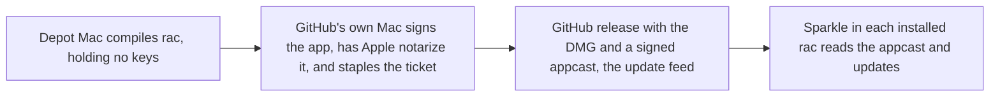

# 06. Engineering platform and shipping

You only need to read the first two sections. The rest is detail for the build thread.

Citation keys: `ci-status` = `plans/context/ci-status.md`. `eng-matrix` = `plans/research/matrices/engineering-and-shipping.md`. Digests are `plans/research/digests/<slug>.md`, cited by slug. The council is `plans/context/inboxzero/{opus,sonnet,kimi-k3}.md`. `run 40222453249` is the last CI validation run (read with `gh run view` and its log artifact on 2026-10-27). FACT = checked in a primary source or the repo. CLAIM = a self-report. INFERENCE = my reasoning.

This plan owns the shared calendar. Weeks are counted from the maintainer's approval: W1 is the first week after it. The only fixed dates are two anchors. The launch build must start by **2026-12-15**. Arc shuts down on **2026-12-22**.

## In plain English

Nobody can install rac yet. This plan ships a signed copy, catches rac up with Helium, and launches it for Arc users.

GitHub's free build machines are too slow and too small to finish a rac build. So rac rents faster Macs from Depot. A build there should cost about $35 to $70 and take most of a day. One free GitHub attempt runs alongside.

First comes a quiet "Preview" release on today's code. Then rac catches up with Helium, from Chromium 154 to 156, over two to three weeks. The second release proves updates reach installed copies. The launch ships that build with Arc import and a safer agent.

The Arc date holds only if you approve the plans by about 11-02, which leaves one spare week. You also set up Depot in about an hour and pick the Mac for the heavy build.

## What you need to decide

| Id | Question | Options | Recommended |
| --- | --- | --- | --- |
| 06-D1 (D5) | Which Mac runs the Helium sync and rebuilds? | The shared Air; the MacBook Pro | The Pro if it has 32 GB RAM and 150 GB free |
| 06-D2 (D4) | How are releases built? | Depot, paid; free GitHub runners; a local Mac | Depot with a $300 monthly cap, plus one free attempt |
| 06-D3 (D7) | Support Intel Macs at launch? | Yes, about $99 a build; no | No, Apple Silicon only for 0.x |
| 06-D4 (D3) | Publish a quiet 0.1.0 on Chromium 154 first? | Yes, labeled "Preview"; wait for the synced build | Yes, then prove updates by going from 0.1.0 to 0.2.0 |
| 06-D5 (D2) | In what order does the work happen? | Ship, sync, launch, then revamp; revamp first; a stable track plus revamp branches | A stable track ships while the revamp builds on branches |
| 06-D6 (D8) | What if the sync isn't merged by the end of week 4? | Launch on 154 as a preview; hold the launch; hold a week, then 154 | Hold one week, then launch on 154 |
| 06-D7 (D18) | How often does rac sync after launch? | Every Chromium major within 14 days; every other major | Every major, reviewed after three cycles |
| 06-D12 (D58) | Move rac's own source files out of patches into a folder? | Yes, after launch; no | Yes, after launch |

- 06-D1. The Pro needs at least 32 GB of RAM and 150 GB free, otherwise the Air. Please send its specs, or let an agent read them.
- 06-D2. Depot only compiles, so the signing keys never leave GitHub. A local build would move them.
- 06-D5. The stable track ships 0.1, the sync, and the launch. The revamp stays in rac-owned files.
- 06-D6. The 154 fallback must start by 12-15.
- 06-D7. Security fixes ship within 7 days if attackers already use the bug, otherwise within 14.

I'll do these unless you object (D10, D11, D60):

- Jump straight to Helium 0.20.1.1, not in two steps.
- Merge nothing under `patches/` until the sync merges, because every new patch also edits `patches/series`, the file the sync conflicts on. Docs, the site, CI, and plans may merge.
- Protect `main`. Every PR needs the Linux checks and your approval. Agents push as a machine user, `rac-bot`, so your approval is a real gate.
- Run C++ tests in the agent's worktree first, and in the release build once they fit.
- Stay off Chromium 157 until after launch.
- Publish speed numbers against Helium if they're ready. If not, soften "never slower" on the site.
- Add a beta channel and crash reports after launch.

## Where we are today

**Releases.** None. `rac_version.txt` is 0.1.0. All nine signing, notarization and Sparkle secrets exist. `MAC_TEAM_ID` is empty, and its effect on a signed build is unknown (FACT, `ci-status`, `rac-baseline`). The feed is `releases/latest/download/appcast-<arch>.xml` in `notkainoa/rac` (FACT, `patches/rac/updates/update-feed.patch:138`). GitHub's `latest` skips prereleases, so every real release must be a full one (FACT, `docs/operations/releases.md`). The DMG is signed but not notarized or stapled (FACT, `sign_and_package_app.sh`).

**The CI build.** `build.yml` builds both architectures in up to 10 chained phases, with `fail-fast: true`. It already takes a `runner` input (FACT). Each phase builds for about 4 h 50 min. It leaves one hour of the 6-hour job limit for setup, signing, notarization and upload (FACT, `.github/scripts/github_build.sh`). PR #20 (`tar --format pax`) is still open (FACT).

**Run 40222453249,** which had the fix, ran 26 h 21 min (FACT):
- Phases now resume.
- In phase 5, arm64 finished 10,263 steps at 0.59 per second, with 3,391 left. The helper apps were linked, but the main framework was not (FACT, phase-5 log).
- x86_64 had 46,220 steps left, because it also builds an arm64 copy of Blink.
- **x86_64 failed in phase 6.** `download-artifact` printed "Starting download", then nothing, so `sums.txt` was missing. **arm64 was cancelled, not failed:** `fail-fast` stopped it 24 minutes into phase 6 (FACT, job list and log).
- After phase 1, sccache hits are about 0%, because the 10 GB Actions cache thrashes (FACT, `ci-status`).

**Free runner limits.** 3 M1 cores, 7 GB RAM (FACT, `helium`). Steps are not time. The tail holds the memory-hungry ThinLTO framework link and notarization, which waits in Apple's queue. A link that outlasts a phase restarts from zero (INFERENCE).

**Larger GitHub runners are not just a label change.** They need an organization on a paid plan, not a personal account like `notkainoa` (FACT, [GitHub runner pricing](https://docs.github.com/en/billing/reference/actions-runner-pricing)). Moving the repo changes the path the permanent feed names. They offer 5 cores and 14 GB at $0.102 a minute, against Depot's 8 cores and 24 GB at $0.08 (FACT; `helium`).

**The local Mac.** The main checkout is on kainoas-macbook-air: an M1 with 8 cores, 16 GB RAM and 101 GB free (FACT, `sysctl`, `df`). Its `build` folder is 25 GB (FACT, `du`; APFS clones may undercount). It is the base every worktree clones (`AGENTS.md`). Local release builds lack the updater, because `write_gn_args` adds `enable_sparkle` only in `ci` mode (FACT, `devutils/shared.sh:58-70`). That is a two-line fix. The MacBook Pro's specs are unknown.

**Checks.** `sanity` fails on offsets, not fuzz, and passes on a 30 s build timeout (FACT, `sanity-check.sh`). 278 C++ and 71 Python tests never run in CI. `main` is unprotected; 70% of commits landed directly (FACT, `rac-baseline`).

**Upstream.** rac is on Helium 0.18.2.1 / Chromium 154. That is six releases and two majors behind 0.20.1.1 / 156. It has never synced (FACT, `helium`). The sync changes the build path: `retrieve_and_unpack_resource.sh` and `devutils/build_tools.sh` are gone upstream, and `prepare_sources` and `configure_build` have new signatures (FACT, `helium`). So a 154 release does not prove the 156 pipeline.

## What others do

- **Nobody finishes Chromium on free GitHub Macs.** Helium pays for Depot M4 runners: arm64 took 2 phases and 6 h 43 min, about $34 (FACT/INFERENCE, `helium`). Ardia builds every release on an M5 Pro, 2.5 h cold (FACT, `ardia`). Cra and Crest build the engine on Macs they own (FACT, `cra`, `long-tail`). Ardia's free x64 chain never finished (FACT, `ardia`).
- **Drift checks.** Cra runs a daily Linux job that opens an issue with the exact command (FACT, `cra`). Zen runs a weekly bot PR (FACT, `zen`). Crest checks every 6 hours and allows no fuzz (FACT, `long-tail`).
- **Gates.** Ardia's smoke test updates the previous build, with a stable-only perf gate (FACT, `ardia`). Stedding ships security fixes in 7 or 14 days and publishes every host a fresh profile contacts (FACT, `long-tail`). No engine-based browser runs engine-side tests in CI (`eng-matrix`).
- **Council.** All three reviewers rank the same things first: one signed release with updates proven, the first sync, Arc import, a safe agent default, and CI with a protected `main` (`opus.md` §8, `sonnet.md` §8, `kimi-k3.md` §8).

## Options

### Build route (A1 to A3)

The real trade is money versus days versus keys leaving GitHub.

**A1. Free GitHub runners, Apple Silicon only.** It costs nothing and touches no Mac. It has never finished. One attempt takes about 30 to 40 hours, and each failure costs a day and a half.
- Details: ask the maintainer to merge PR #20, add an `arches` input (default `arm64`), and set `fail-fast: false`. Retry the checkpoint download at the step level, check the artifact digest, and fail clearly.
- Evidence against: the remaining steps hold the framework link, on 7 GB of RAM. Phase 6 never got that far. Six or seven phases is a guess (INFERENCE).
- Effort S: about 2 agent-days. Risk: high for the schedule.

**A2. Depot runners (M4, 8 cores, 24 GB).** The same CI on faster rented Macs, used only to compile. Helium's arm64 build takes about 7 hours there. Signing, notarization, stapling, and appcast signing run in a final job on GitHub's own `macos-latest` runner, so the keys never go to Depot.
- Cost per attempted build: about $35 warm, maybe $70 for the first cold one (INFERENCE from `helium`), plus a plan of about $20 a month.
- Expected builds: about 6 to 8 per month before launch (0.1.0, the 156 pipeline, launch candidates, retries). After launch, about 4 to 6 (two syncs, point and security releases). That is roughly $150 to $300 a month.
- Who acts: only the maintainer can create the account, set billing and a spending limit, and install the GitHub app. That takes about an hour, on day one of W1.
- Pros: 2 phases, a working cache, room for test targets, and a realistic 14-day cadence. Cons: spend and a vendor; ask about open-source terms.
- Effort S: about 1 agent-day after signup. Risk: low.

**A3. Build and sign on a local Mac.** Ardia's pattern.
- Details: a 10 to 16 h overnight build (INFERENCE). It needs the two-line `enable_sparkle` fix, a temporary keychain with `set-key-partition-list` so no keychain dialog appears, an App Store Connect API key for `notarytool`, and a stapled DMG.
- Fit with "never take the foreground": the build runs in the background. Test launches use `--rac-launch-in-background` with a throwaway profile, and DMGs mount with `hdiutil attach -nobrowse`.
- Cons: the signing keys and the Sparkle private key leave GitHub and sit beside the real profile. Nothing is proven in CI. It competes with the sync for the same Mac. It needs approval for a full build.
- Effort M: about 3 agent-days plus the build. Risk: medium.

Rejected:
- Local build with signing in CI. It still needs A3's build.
- A self-hosted runner. The repo is public, so a stranger's PR could run code on the Mac (`eng-matrix`).
- Larger GitHub runners. They need an organization, which puts the permanent feed path at risk, and they are slower per dollar than Depot (see "Where we are today").

**Recommendation: A2, with one A1 attempt in parallel in W1.** If A1 finishes, it becomes the free fallback for point releases. A3 is the emergency path for the slip rule (06-D6).

### Intel (B1, B2)

**B1. Apple Silicon only.** macOS 27 drops Intel, as do Ardia, Nook and Crest (FACT, `helium`, `eng-matrix`). Trap: once Intel ships, every release must carry `appcast-x86_64.xml`, or Intel copies stop updating (INFERENCE). **B2. Both:** about $99 a build on Depot (INFERENCE, `helium`). **Recommendation: B1 for 0.x.**

### Sequencing (C1 to C3)

**C1. Ship today's code quietly, sync, launch, then revamp.**
- Pros: the update loop exists before strangers install. The sync happens while it is cheapest: failed hunks went from 43 to 104 in one Helium release (FACT, `helium`). Revamp patches are written once, on 156.
- Cons: launch ships today's UI, and the redesign follows. Keep familiar behavior reachable (Zen's lesson, `zen`).

**C2. Revamp first,** or **C3. revamp before the sync:** sync debt grows weekly, revamp patches need rebasing, and the Arc window likely closes first.

**Recommendation: C1.** Under ruling 1 (`plans/rulings.md`), work in rac-owned files may be built on 154 now and rebased. Work that touches hot upstream files waits for the sync.

### Cadence (E1, E2)

**E1. Every feature major within 14 days of Helium's first release for it.** Security fixes go out separately: 7 days if exploited in the wild, otherwise 14 (Stedding's rule, `long-tail`). It needs A2. Each cycle costs 1 to 3 agent-days plus a build, if hunks shrink (INFERENCE, `rac-baseline`).

**E2. Every other major, plus security.** Half as many syncs, but each roughly doubles (INFERENCE from 43 to 104).

**Recommendation: E1.** Fall back to E2 if a sync takes more than 3 agent-days for three cycles in a row.

### Source overlay for 06-D12 (I1, I2)

**I1. Keep rac's 325 new files (43k lines) inside patches.**

**I2. Move them into a plain `rac-src/` folder.** A step like `replace_resources.py` copies them into `build/src`, or dev trees link them, as Zen does (FACT, `devutils/shared.sh:14-20`; `zen`). PR diffs then show real code, not diffs of diffs: today 658 self-edits carry 26k lines of churn (FACT, `rac-baseline`). It changes every agent's workflow. Effort M: 5 to 8 agent-days.

**Recommendation: I2, after launch.** The Ship thread implements it, after a throwaway-worktree spike on copy versus link.

## Recommended plan

### Critical path

"Chromium" is the version the work targets. "Gate" must pass before the next row starts.

| Week | Chromium | Work | Gate | Owner |
| --- | --- | --- | --- | --- |
| W1 | 154 | M0 pipeline. Depot signup, day 1. Sync worktree set up. Cold build of the 156 tree, timed. | Depot chain green; free attempt started | 06, maintainer |
| W1-W2 | 154 | M1 quiet 0.1.0 | Smoke on the CI artifact before publishing | 06 |
| W1-W3 | 154 to 156 | M2 sync. Plans 01, 04 and 05 build rac-owned files on 154. | Sync merged by end of W3, slack to W4 | 06 (Opus for design merges) |
| W3-W4 | 156 | Base-tree rebuild. Every worktree resyncs. Rac-owned work rebases. | Base built; `worktree.sh sync` works | 06, then each plan |
| W4 | 156 | M3 0.2.0, the first synced release; update loop proven | `update-smoke` 0.1.0 to 0.2.0 | 06 |
| W2-W5 | 154, then 156 | M4 checks, protection, evidence | Host list and bench run on 0.2.0 | 06 |
| W5 | 156 | M5 launch candidate 0.2.x with gates G1 to G15; launch | Every launch gate checked | 06 + 04 + 05 |
| W6 | 156 | Float; one optional point release (D16) | `update-smoke` passes | 06 |

Anchors:
- Approval by 11-02 puts W5 at 11-30 to 12-06, with W6 as float.
- Approval by 11-09 puts W5 at 12-07 to 12-13, with no float.
- Later approval leaves only the 06-D6 slip path.

**Slip rule (06-D6).** If the sync isn't merged by the end of W4, hold one week. If it still isn't merged, build the launch on 154 with the launch gates rebased back. Label it "Preview, Chromium 154", and sync right after launch. The 154 fallback must start by 12-15.

**Launch gates:** G1 to G15 in `plans/00-master-plan.md`. M5 checks every one.

Plan 01's launch items, such as the command bar (D16 in decisions.md), ship if they merge by the start of W5. They are not gates. One optional point release in W6 carries what missed it, only if `update-smoke` passes.

### M0. Pipeline (W1)

Goal: a release chain that finishes, plus cheap checks on every PR.

Tasks:
1. **Maintainer, day 1:** create the Depot account, set a $300 monthly limit, and install the GitHub app.
2. Ask the maintainer to merge PR #20.
3. Harden the checkpoint download in `build-phase.yml`:
   - Retry at the step level: re-run `download-artifact`, or fall back to `gh run download`.
   - Compare the digest reported at upload with the downloaded file.
   - Fail clearly after 3 attempts. If the upload itself was short, re-download won't fix it, so also check the archive size and digest in the uploading job.
4. Add an `arches` input (default `arm64`) and set `fail-fast: false`. Make the release scripts and `github_write_appcasts.sh` handle only the arches built.
5. Point the build at `depot-macos-latest` through the existing `runner` input, with Depot Cache for sccache. Compile on Depot. Sign, notarize, staple, and sign the appcast in a final job on a GitHub-hosted `macos-latest` runner. Signing needs no big machine, so the secrets never reach Depot. In parallel, start one free `macos-latest` attempt.
6. Make non-release builds refuse to start on the default `me.kainoa.rac` user-data folder, so a stray launch can never open the maintainer's real profile. Dev runs already pass `--user-data-dir`.
7. Add PR checks on Linux:
   - the 71 Python tests;
   - `he validate series`;
   - a no-fuzz sparse apply (method in `plans/research/helium.md` lines 582-599);
   - plan 03's patch-surface counter (ruling 11).
   Make `sanity-check.sh` fail on "with fuzz" too. Ask the maintainer about `pullfrog.yml` (a maintainer-installed workflow); don't delete it.

Acceptance: a Depot arm64 chain finishes; a forced bad download is retried or fails clearly; PR checks take under 15 minutes. Verification: run links, phase timings and peak memory. Patch surface: none.

Effort: about 3 agent-days (Sonnet), plus an hour of maintainer time.

### M1. Quiet 0.1.0 on 154 (W1-W2)

Goal: the first signed, notarized release works on a clean Mac. Nobody is told about it.

Tasks:
1. Preflight:
   - Check the empty `MAC_TEAM_ID` under real signing.
   - Check that the entitlements profile covers every claimed entitlement. An app that claims more than its profile grants won't launch (`eng-matrix`).
   - Notarize and staple the DMG.
2. Add an `install-smoke` job that runs on the **CI artifact, before the release step publishes anything**. On a free macOS runner (a clean Mac):
   - attach the DMG with `-nobrowse`;
   - run `spctl -a -vv`, `codesign --verify --deep --strict` and `stapler validate`;
   - launch with a throwaway profile and `--rac-window-screenshot`, and check the PNG has real pixels;
   - confirm the updater reaches the real feed without an error.
3. Publish 0.1.0. The note says: "Preview. Not for daily use. Chromium 154." Keep `RELEASE_READY = false`.
4. **Bad-release runbook** in `docs/operations/releases.md`:
   - Un-publish fast by flipping the bad release to a prerelease. `latest` then falls back to the previous release, so nobody new is offered the bad one (INFERENCE from `latest` skipping prereleases).
   - Fix forward with a higher version within 48 hours. Versions never go down.
   - If a build can't launch, its users must download again by hand. Post a note on the release and the site.
   - Only the maintainer decides. An agent flips a release only on their word.
   - Test that a lower version is never offered.

Acceptance: 0.1.0 is public, smoke passes, the runbook exists. Verification: runner logs and About rac screenshots; nothing runs on the shared Mac. Effort: 2 to 3 agent-days (Opus for signing). Risk: 0.1.0 is linkable, since "quiet" is not access control; flip it to a prerelease once 0.2.0 ships.

### M2. Sync to Helium 0.20.1.1 / Chromium 156 (W1-W3, slack to W4)

Goal: every rac feature works on 156.

Tasks:
1. **Day 1:** answer 06-D1. Restore the fetch-only `upstream` remote: `git remote add upstream https://github.com/imputnet/helium-macos && git remote set-url --push upstream no_push`. Start the freeze (nothing under `patches/` merges until the sync does).
2. In a `sync/helium-0.20.1.1` worktree on the chosen Mac, merge the tag. Only `patches/series` should conflict (FACT, `helium`).
3. Adopt the new `prepare_sources` and `configure_build` signatures and Helium's prepared tarballs. Start the cold build at once: it measures the rebuild time every later plan depends on.
4. **Mechanical fixes** (parallel; Sonnet or open-weight): `ui/BUILD.gn`, the moved `tabs/` files, context drift.
5. **Design merges** (serial; Opus):
   - Port sidebar-reveal onto Helium 0.20's expand-on-hover overlay (ruling 6). Plan 01 owns the dwell and grace values, reconciled with Helium's 150 ms hide grace and 3 s exit grace. Plan 02 owns the motion tokens.
   - Move settings onto Helium's Layout section, with one hook that hides unsupported layouts.
6. **Compile fixes** (serial after step 5): rac's 325 new files and the agent's actor calls (`type_tool.cc` changed 332 lines, FACT, `helium`).
7. Refresh with fuzz 0. Fix the two stale docs (`overview.md:69`, `upstream-sync.md`).
8. Run the five test targets, the Python tests, and the AGENTS.md surface checklist. Add PWA windows (ruling 17).

Acceptance: a clean fuzz-0 `quilt push -a` and passing targets. Screenshots of sidebar full and hidden, edge reveal, light and dark, two themes, both address-bar positions, incognito, split view, onboarding and a PWA window. A video of edge reveal and a space swipe.

Effort: L, about 8 to 12 agent-days. About half is serial (steps 5 and 6). Calendar: 2 to 3 weeks. The matrix's "3 to 7 days plus a rebuild" left out the unknown compile work (`eng-matrix`).

**Base-tree rebuild (W3-W4):** after the merge, the main checkout's tree moves to 156. This needs approval for `he reset` and a full build. Every worktree then runs `worktree.sh sync` or is recreated. It is an explicit dependency for plans 01, 03, 04, 05 and 07.

### M3. 0.2.0, the first synced release (W4)

Goal: prove the 156 pipeline and the update loop in one step.

Tasks:
1. Run a Depot chain on the new build path. Treat it as unproven until it finishes.
2. `update-smoke` on a free runner:
   - install 0.1.0;
   - make a space and a pinned tab;
   - let Sparkle update to 0.2.0 from the real feed, then relaunch;
   - confirm 0.2.0, data carried over, no Keychain prompt, and no offer of a lower version.
3. Publish 0.2.0 quietly.
4. Add the drift detector: a daily, read-only Linux job that sparse-applies each new helium-macos tag at fuzz 0 and updates one rac issue with failing patches and exact commands (Cra and Zen patterns).

Acceptance: `update-smoke` passes, and the detector has opened its first issue.

Effort: about 3 to 4 agent-days.

### M4. Checks, protection and evidence (W2-W5)

Tasks:
1. **Protect `main`** with a ruleset:
   - Require a PR, the M0 checks, and 1 approval from the maintainer.
   - Block force-pushes and deletion. Allow a maintainer bypass.
   - Don't require linear history: Helium syncs are merge commits (FACT, `docs/operations/upstream-sync.md`).
   - Agents push as the machine user `rac-bot`. Commits stay authored by Kainoa Newton, so the approval is a real gate.
2. **`devutils/rac/test.sh`** builds and runs the affected test targets in the worktree and posts a `rac/unit-tests` status. It is a reminder, not a gate: the same machine posts it. The real gates are the Linux checks and the approval. Add the PR flow to `AGENTS.md` in one short section.
3. **Network capture.** A free runner installs the release DMG and runs a fresh profile for 10 minutes with `--log-net-log`, before and after Helium-services consent. It compares the hosts contacted with a published list (Stedding's pattern, `long-tail`).
4. **Speed bench** in `devutils/rac/bench/`. It drives rac and the Helium release on the same Chromium major over DevTools, with throwaway profiles. It measures cold launch, new tab, tab switch, sidebar reveal, memory at 1, 10 and 20 tabs, and idle CPU and wakeups. Rounds are interleaved, reporting medians with min and max (Ardia's method).
   - Advisory on free runners, after measuring the noise floor from 10 repeats. The release gate is one run on an idle real Mac.

Acceptance: an unapproved PR can't merge. One host list and one bench table are published.

Effort: about 6 to 8 agent-days.

### M5. Arc-refugee launch (W5)

Tasks:
1. Check every launch gate, then build the launch candidate on Depot.
2. Fix public claims: "thin layer", "It asks before it acts", "four weeks" (`rac-baseline`).
3. The site says "Apple silicon, macOS 13+". Load a DRM test page in the release DMG first. Then state the real Netflix-class DRM status.
4. Add a "Moving from Arc" page and comparison pages. Flip `RELEASE_READY` and add the Vercel deploy hook (`docs/operations/releases.md`).
5. Draft Show HN, r/ArcBrowser and Product Hunt posts. The maintainer posts them.
6. Measure success only by GitHub download counts, with no analytics. Add issue templates for crashes and import. A triage agent labels issues and never closes them.

Acceptance: a clean runner goes from download to imported Arc spaces in under 5 minutes, on video.

Effort: about 4 agent-days (UI rule for site pages).

### Later (after launch)

- **First cadence sync,** in W6 or W7. Target the current Helium. If the detector shows more than about 100 failed hunks, step through one middle major.
- **Beta channel.** One appcast with `<sparkle:channel>` (Ardia, `ardia`), with beta DMGs on prereleases. Betas take the next patch numbers, and a good beta is promoted unchanged. Users get one "Get beta updates" switch on About rac, and `RAC_DMG_STYLE=beta` already exists (FACT, `sign_and_package_app.sh`). Effort S.
- **Crash reports, server-free.** After a crash, one calm line asks whether to send a report. Yes shows stack frames and modules, with no page memory. The user opens a prefilled GitHub issue, and the maintainer symbolicates with stored `.dSYM` files. A rac crash server (Helium's AGPL `minidumpster`) only if these reports prove too thin. Effort M.
- **Test targets in the release chain,** once Depot builds finish in 2 phases.
- **Source overlay (06-D12)** and patch thinning against plan 03's targets.
- **Intel,** only with Depot and demand.
- **Golden screenshots,** stored as release assets, not on `main`.

## Fit with the non-negotiables

- **Private.** Nothing new phones home; GitHub counts downloads; crash reports stay server-free and per-crash. The network capture makes the claim evidence. Watch: launch sends more users to Helium's services, whose terms don't cover forks (FACT, `helium`); keep `origin_override` ready.
- **Never slower than Helium.** It gets measured for the first time. The site line is softened if the numbers aren't ready.
- **AI off costs nothing.** Unchanged. The test targets include `MasterSwitchGatesEntryPoints`. Plan 05 owns the wider checks, and ruling 16's "no AI labels with AI off" becomes part of M2's screenshot checks.
- **Cheap to update.** This plan carries it: the detector, the 14-day cadence, the no-fuzz gate, plan 03's counter, and the overlay.
- **Calm UI and GPL-3.0.** Unaffected.
- **Bent, with reasons.** 0.1.0 ships Chromium 154 as a labeled, short-lived preview, so updates are proven before anyone relies on them. The 06-D6 slip path could launch on 154; that is the maintainer's call. Paying a vendor is new, but it is not a non-negotiable.

## Dependencies on other plans

- **01.** The sidebar-reveal port happens in M2, and plan 01 sets its behavior values (ruling 6). Plan 01 work on hot files lands after the base rebuild (W4). Its launch items are optional, merged by the start of W5.
- **02.** It owns the motion token names used in the reveal port. The bench measures frame times.
- **03.** It defines the patch-surface metric, which M0 runs as a check (ruling 11). It does not implement the overlay; this plan owns the move (06-D12).
- **04.** M0 task 3 (M0b, Keychain) and M1 (Arc sidebar import) are launch gates. Both build in rac-owned files on 154 during W1-W3 and rebase in W4.
- **05.** M0 is a launch gate. It owns the debug doors (05-D6, ruling 7). Its eval tier 1 runs in CI once test targets compile.
- **07.** Power patches land after the bench. Features wait for the base rebuild.

## Risks and unknowns

- **Depot unknowns.** Rate, cold-build time and terms are unconfirmed. If signup slips, A1 is the only path, at about 1.5 days per attempt.
- **The sync's compile cost** is unmeasured, since the dry run checks text only (FACT, `helium`). Chromium 157 lands 11-03, mid-sync. Ignore it until launch.
- **The heavy Mac.** M2's builds and the base rebuild compete with every worktree. If a rebuild takes more than about 8 hours, the 14-day cadence crowds out features.
- **First-signing surprises** (team ID, entitlements, Sparkle's consent prompt): M1 smoke catches them.
- **Launching on 156 in December** means Chromium is three majors old at launch, without 157-plus security fixes (INFERENCE). The first cadence sync is the fix.

## Open questions

1. What are the MacBook Pro's RAM and free disk? This answers 06-D1.
2. Will Depot offer open-source terms? What does a cold rac build cost there?
3. Does an official build tree compile the five test targets cheaply?
4. Does a signed first launch ask for update consent? Does Keychain prompt across an update?
5. Is a 5% tolerance against Helium right, or 0% for typing and tab switch?
6. Note on rejected findings: "Larger GitHub runners need only a label change." Rejected. They need an organization on a paid plan, which moves the repo path the permanent feed names, and they cost more per build than Depot.
7. Note on rejected findings: "Disk fits only as an APFS clone." I withdrew this claim. `du` shows 25 GB, so a second tree fits.

## Draft thread brief

Thread brief: see `plans/threads/ship.md`.
